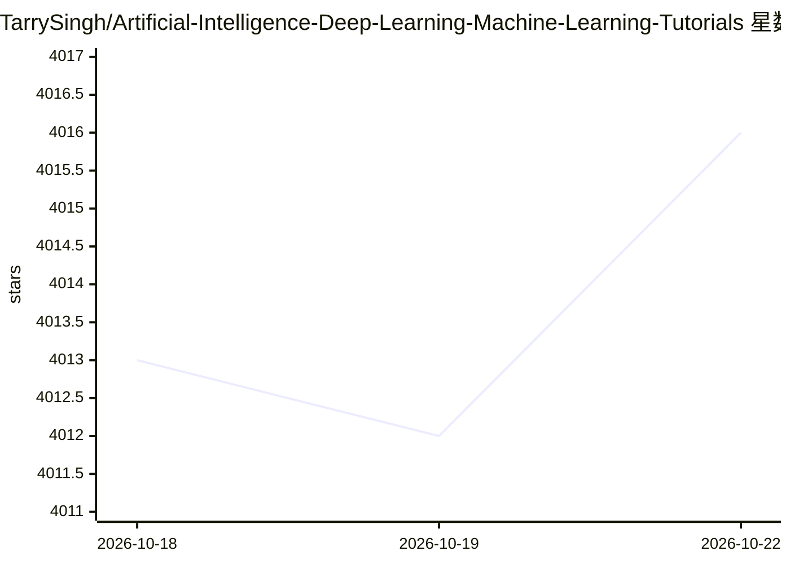

# TarrySingh/Artificial-Intelligence-Deep-Learning-Machine-Learning-Tutorials

⭐ 4,016 · Python · NOASSERTION · 推送 2026-10-22 · [GitHub](https://github.com/TarrySingh/Artificial-Intelligence-Deep-Learning-Machine-Learning-Tutorials) · [官网](https://synapsa.realai.eu) · 组织维护

**免费动手 AI 课程库：77 节可在浏览器本地运行的自测课**

Synapsa 团队维护的实践型 AI 课程仓库，共 77 节通过 14 项质量门与独立评审的课程，以 Jupyter notebook 交付，可在 Colab、Kaggle、Binder、Codespaces 或本地 Jupyter 运行；每节练习填空后自动判分并给出提示。内容分轨道（语言模型、推理系统、RAG、Agent 等）与行业项目（EU AI Act 合规、文档抽取、预测性维护、模型风险、蛋白质组学、仿真人形机器人）。多数课程 CPU 即可运行，7 节含 C/C++ 练习需 make 与编译器，PyTorch 为可选安装。2017-2025 旧教程已归档。

## 筛选速览

| 维度 | 判定 | 备注 |
|---|---|---|
| AI 角色 | `ai-knowledge` | 知识聚合/清单类 |
| 许可风险 | `none` | NOASSERTION |
| 部署形态 | `library` | 以包/库形式分发 |
| 模型依赖 | — | README 未给出锁定关系 |
| 硬件要求 | — | 无带数字的原话,不猜 |
| 安装摩擦 | `medium` | 含编译或系统依赖之一 |
| 成熟度 | — | 结构信号不足 |

## 能力要点

- 77 节课程全部通过 QUALITY.md 的 14 项质量门并经独立评审
- 练习单元运行即自检，配两级提示与进度板
- 覆盖 EU AI Act 合规、文档智能、预测性维护、模型风险等行业项目
- notebook 可在 Colab/Kaggle/Binder/Codespaces/本地 Jupyter 五种环境运行

## 适用场景

- 想系统学习 AI 工程与推理系统的 ML 工程师按轨道进阶
- 受监管行业从业者学习 EU AI Act 合规证据与模型验证
- 零基础者在浏览器中动手完成第一门 8GB 入门课

## 场景标签

`教程课程` · 领域:学习与行业

## 证据(README 行号)

> L3:  Free, hands-on AI courses that run anywhere , from the team building Synapsa, an AI-native learning platform.
> L52: **77 lessons, every one passing all 14 gates in `QUALITY.md` and independently reviewed.** 7 are compiled C or C++ 

## 星数曲线

2026-10-18 4,013 → 2026-10-22 4,016（+3）

---
*卡片 v1 · prompt 1.4 · 生成 2026-10-20 · 置信度 mid · 依据 README sha `785acef1dc7a` · [字段定义](../../DATASET.md)*
