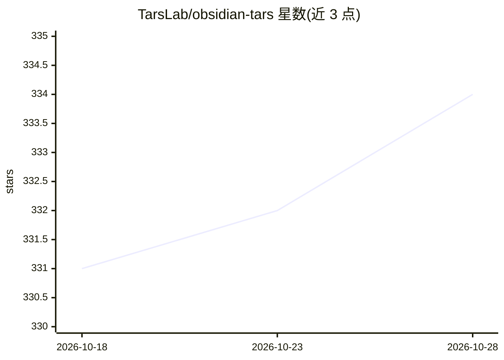

# TarsLab/obsidian-tars

⭐ 333 · TypeScript · MIT · 推送 2026-08-28 · [GitHub](https://github.com/TarsLab/obsidian-tars) · 个人维护 · 中文 README

**Obsidian 标签触发多模型对话插件：#标签即问 AI**

在 Obsidian 笔记内通过 #标签（如 #Claude :）触发 AI 对话与文本生成的插件，支持桌面与移动端。接入 16 家服务商（OpenAI、Claude、DeepSeek、Ollama、SiliconFlow 等），对话遵循 system/user/assistant 交替规则，支持内链、JSONL 数据集导出（配合 ms-swift 微调）。3.1 版增加多模态：GPT-Image-1 图像生成、图像与 PDF 分析（仅限嵌入文件）。模型列表来自各服务商 API，可通过设置覆盖 baseUrl 与模型参数。

## 筛选速览

| 维度 | 判定 | 备注 |
|---|---|---|
| AI 角色 | `ai-native` | 本体是模型或模型工具 |
| 许可风险 | `permissive` | MIT |
| 部署形态 | `library` | 以包/库形式分发 |
| 模型依赖 | local-ok | 支持本地模型 |
| 硬件要求 | — | 无带数字的原话,不猜 |
| 安装摩擦 | `low` | 无编译、无系统依赖或容器化 |
| 成熟度 | — | 结构信号不足 |

## 能力要点

- #标签触发 AI 对话，支持命令面板/直接输入两种方式
- 16 家 AI 服务商接入，支持自定义 baseUrl 与参数覆盖
- 对话可导出 JSONL 数据集，配合 ms-swift 微调
- 多模态：图像生成（GPT-Image-1）与图像/PDF 分析

## 适用场景

- 在笔记中直接向 AI 提问并保留对话记录
- 用标签语法组织多轮对话并切换不同模型
- 把笔记中的对话导出为微调数据集

## 场景标签

`聊天机器人` `图像生成` · 领域:对话与助手

## 证据(README 行号)

> L6: Tars is an Obsidian plugin that supports text generation based on tag suggestions, using services like Claude, OpenA
> L80: - Add an AI assistant in the settings page, set the API key, and configure the model.
> L82: - Select an assistant from the command list, like "#Claude :", to trigger the AI assistant to answer the question.

## 星数曲线

2026-10-18 331 → 2026-10-28 334（+3）

---
*卡片 v1 · prompt 1.4 · 生成 2026-10-22 · 置信度 high · 依据 README sha `4eb3202f618b` · [字段定义](../../DATASET.md)*
