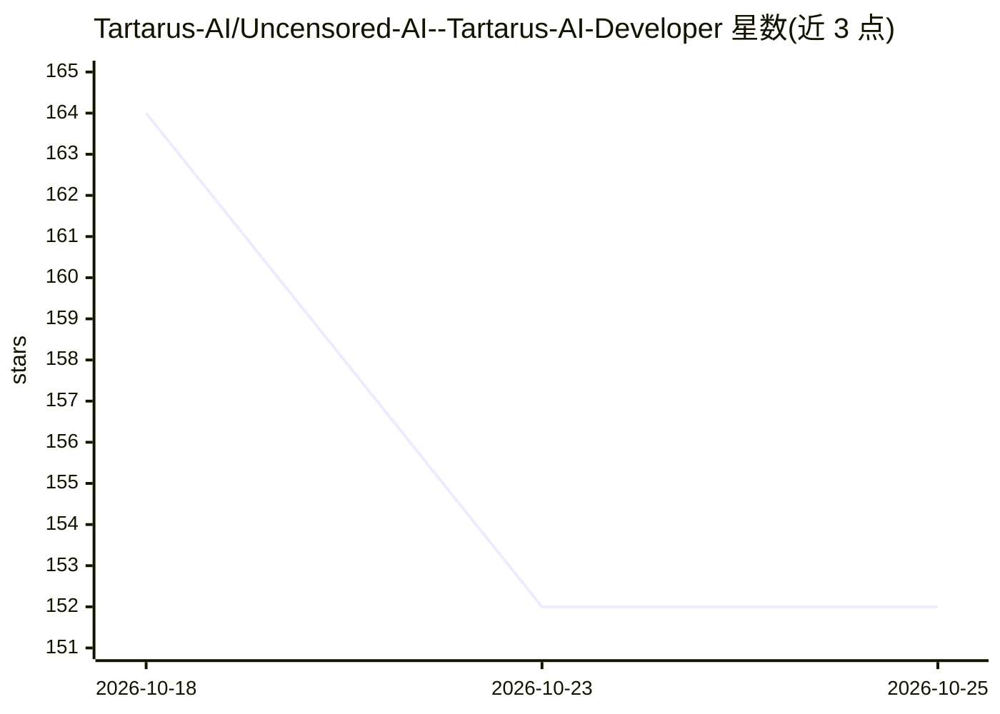

# Tartarus-AI/Uncensored-AI--Tartarus-AI-Developer

⭐ 152 · MIT · 推送 2026-09-27 · [GitHub](https://github.com/Tartarus-AI/Uncensored-AI--Tartarus-AI-Developer) · [官网](https://tartarusai.dev) · 组织维护

**付费的终端 AI 编程代理，主打不拒绝的编码助手**

TartarusAI 提供名为 tartarusai-cli 的终端客户端，连接其无内容过滤的 AI 编程代理服务；支持 256K 上下文、整仓单次提示。商业模式为加密货币（USDT/BTC/ETH）预付费，可选 1/3/12 个月，无需绑卡，付款后约 30 秒可用，提供 14 天退款。客户端支持 Linux/Windows，MIT 许可。声明仅限实验室/研究/CTF/合法红队用途，禁止恶意软件与盗版。

## 筛选速览

| 维度 | 判定 | 备注 |
|---|---|---|
| AI 角色 | `ai-native` | 本体是模型或模型工具 |
| 许可风险 | `permissive` | MIT |
| 部署形态 | `None` |  |
| 模型依赖 | — | README 未给出锁定关系 |
| 硬件要求 | — | 无带数字的原话,不猜 |
| 安装摩擦 | `low` | 无编译、无系统依赖或容器化 |
| 成熟度 | — | 结构信号不足 |

## 能力要点

- 终端客户端 tartarusai-cli（Linux/Windows，MIT 许可）
- 256K 上下文，整仓放入单次提示
- 加密货币预付费（USDT/BTC/ETH），无绑卡与订阅
- 14 天无理由退款

## 适用场景

- 在终端里让 AI 代理完成编程任务
- 红队/CTF/研究场景下使用不拒绝请求的编码代理
- 不使用信用卡、以加密货币付费获取 AI 服务

## 场景标签

`编码 Agent` `网络安全` · 领域:编码与开发

## 证据(README 行号)

> L9: 🩸 **Uncensored AI coding agent.** Does the work, skips the sermon.
> L21: |`tartarusai-cli`|Terminal client for the uncensored AI agent · Linux / Windows · MIT|

## 星数曲线

2026-10-18 164 → 2026-10-25 152（-12）

---
*卡片 v1 · prompt 1.4 · 生成 2026-10-22 · 置信度 mid · 依据 README sha `f12f578c29dd` · [字段定义](../../DATASET.md)*
