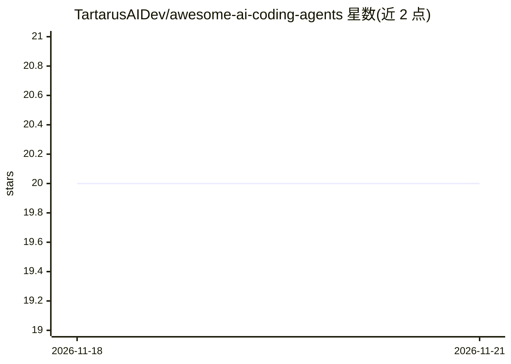

# TartarusAIDev/awesome-ai-coding-agents

⭐ 20 · Python · CC0-1.0 · 推送 2026-11-17 · [GitHub](https://github.com/TartarusAIDev/awesome-ai-coding-agents) · [官网](https://tartarusai.dev/?utm_source=github&utm_medium=repo-homepage&utm_campaign=awesome-ai-coding-agents&utm_content=about) · 组织维护

**AI 编程 agent 策展对比清单：42 款工具的结构化数据**

由 Tartarus AI 维护的 AI 编程 agent 目录：收录 42 款工具（30 开源、12 专有），按 CLI、IDE、自主 agent 三类组织，并提供开源、本地模型、多供应商、可跑测试等交叉对比视图。每行数据区分两类：license/stars/last-commit 从 GitHub API 按验证日期拉取；category、local 支持等字段为编辑标注。数据存于 data/agents.json，附带纯标准库的查询脚本，无需安装即可用 python scripts/agents.py 切片。声明收录不代表背书，不评质量与基准分。

## 筛选速览

| 维度 | 判定 | 备注 |
|---|---|---|
| AI 角色 | `ai-knowledge` | 知识聚合/清单类 |
| 许可风险 | `viral` | CC0-1.0 |
| 部署形态 | `None` |  |
| 模型依赖 | — | README 未给出锁定关系 |
| 硬件要求 | — | 无带数字的原话,不猜 |
| 安装摩擦 | `low` | 无编译、无系统依赖或容器化 |
| 成熟度 | — | 结构信号不足 |

## 能力要点

- 42 款 agent（30 开源/12 专有）三类目录与多个交叉对比视图
- 数据区分 GitHub API 来源核验字段与编辑标注字段，每行带验证日期
- 提供 data/agents.json 数据集与零依赖 Python 查询脚本
- 定时工作流复查链接并标记过期数据

## 适用场景

- 挑选适合自己的 CLI/IDE/自主编程 agent
- 按开源许可或本地模型支持筛选工具
- 用数据集自行做筛选与排序分析

## 场景标签

`精选清单` · 领域:学习与行业

## 证据(README 行号)

> L5: > A curated and regularly verified guide to AI coding agents, CLI coding tools,
> L16: Every row has a verified date. The data lives in `data/agents.json`
> L217: Everything above is generated from `data/agents.json`. The

## 星数曲线

2026-11-18 20 → 2026-11-21 20（+0）

---
*卡片 v1 · prompt 1.4 · 生成 2026-11-18 · 置信度 high · 依据 README sha `bf865348a404` · [字段定义](../../DATASET.md)*
