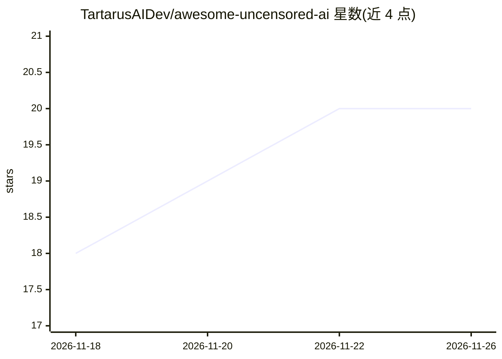

# TartarusAIDev/awesome-uncensored-ai

⭐ 20 · NOASSERTION · 推送 2026-11-17 · [GitHub](https://github.com/TartarusAIDev/awesome-uncensored-ai) · [官网](https://tartarusai.dev/?utm_source=github&utm_medium=repo-homepage&utm_campaign=awesome-uncensored-ai&utm_content=about) · 组织维护

**无审查、可本地运行的 AI 工具策展清单**

策展型 awesome 清单，收录无审查且可本地运行的 AI 工具，覆盖编码 agent、SDK、模型运行时、去审查技术、基准测试与指南六个板块；条目以开源或可自托管为收录原则，hosted 服务单独标注。去审查部分整理 Abliteration、微调/DPO、系统提示词干预等方法并附论文出处；另提供 VRAM 需求估算与自托管硬件选购指引。面向有此类需求的开发者和研究人员。

## 筛选速览

| 维度 | 判定 | 备注 |
|---|---|---|
| AI 角色 | `ai-knowledge` | 知识聚合/清单类 |
| 许可风险 | `none` | NOASSERTION |
| 部署形态 | `library` | 以包/库形式分发 |
| 模型依赖 | — | README 未给出锁定关系 |
| 硬件要求 | — | 无带数字的原话,不猜 |
| 安装摩擦 | `low` | 无编译、无系统依赖或容器化 |
| 成熟度 | — | 结构信号不足 |

## 能力要点

- 覆盖编码 agent、SDK、模型运行时、去审查技术、基准、指南六大类
- 条目以开源或可自托管为原则，hosted 服务单独标注
- 整理 Abliteration 等去审查技术并附研究论文出处
- 提供自托管场景的 VRAM 与显存带宽选购指引

## 适用场景

- 寻找不做拒绝的主流替代型编码 agent 与本地模型运行时
- 了解去审查（abliteration/微调）技术的原理与论文来源
- 评估本地运行 30B 级模型所需的显存与硬件配置

## 场景标签

`精选清单` · 领域:学习与行业

## 证据(README 行号)

> L7: > A curated list of uncensored and locally-runnable AI: coding agents, SDKs,
> L14: Everything here is open source or self-hostable unless marked **hosted**.

## 星数曲线

2026-11-18 18 → 2026-11-26 20（+2）

---
*卡片 v1 · prompt 1.4 · 生成 2026-11-18 · 置信度 mid · 依据 README sha `e87051dd93d7` · [字段定义](../../DATASET.md)*
