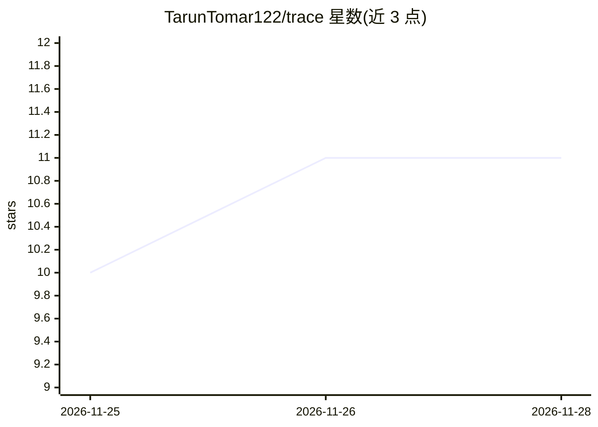

# TarunTomar122/trace

⭐ 11 · TypeScript · AGPL-3.0 · 推送 2026-11-27 · [GitHub](https://github.com/TarunTomar122/trace) · [官网](https://www.yourtrace.online) · 个人维护

**自托管科技与 AI 新闻日报生成器，支持 MCP 接入 AI 助手**

Trace 每天从 100+ RSS/Atom、Hacker News、Reddit、Product Hunt、X 等来源抓取新闻，将同一事件的报道合并为单张卡片，按覆盖度、来源权重、时效和 LLM 编辑（OpenAI structured outputs）排序并生成摘要，以 Web feed、每日邮件、公共存档、Android 应用、Chrome 新标签页扩展等形式交付。提供只读远程 MCP 服务器（OAuth 2.1 + PKCE），AI 助手可经 Google 登录读取日报；支持 Docker Compose 一键自托管，AGPL-3.0 许可，登录依赖 Firebase Authentication。

## 筛选速览

| 维度 | 判定 | 备注 |
|---|---|---|
| AI 角色 | `ai-native` | 本体是模型或模型工具 |
| 许可风险 | `viral` | AGPL-3.0 |
| 部署形态 | `library` | 以包/库形式分发 |
| 模型依赖 | — | README 未给出锁定关系 |
| 硬件要求 | — | 无带数字的原话,不猜 |
| 安装摩擦 | `low` | 无编译、无系统依赖或容器化 |
| 成熟度 | — | 结构信号不足 |

## 能力要点

- 100+ 来源抓取，同一事件多源合并为单卡片并附全部出处
- OpenAI structured outputs 参与排序与摘要，摘要按文章缓存控制成本
- 只读远程 MCP 服务器：Claude/ChatGPT/Cursor/Codex/Gemini CLI 均可接入
- Docker Compose 自托管栈（LocalDB + pipeline + Web 应用），无需 GPU

## 适用场景

- 每天 5 分钟速览科技与 AI 要闻，少读重复报道
- 定制主题与篇幅的每日邮件摘要
- 让 Claude/ChatGPT 等 AI 助手通过 MCP 读取当天新闻简报
- 在自有服务器上部署私有新闻聚合服务

## 场景标签

 · 领域:新闻聚合/内容工具

## 证据(README 行号)

> L6: Trace reads tech and AI news from over a hundred sources every morning, groups
> L32: Trace is a read-only remote MCP server at `https://www.yourtrace.online/api/mcp`.
> L68:  structured outputs) decide what makes the cut and what is worth an email.

## 星数曲线

2026-11-25 10 → 2026-11-28 11（+1）

---
*卡片 v1 · prompt 1.4 · 生成 2026-11-24 · 置信度 high · 依据 README sha `f36df8f6c10a` · [字段定义](../../DATASET.md)*
