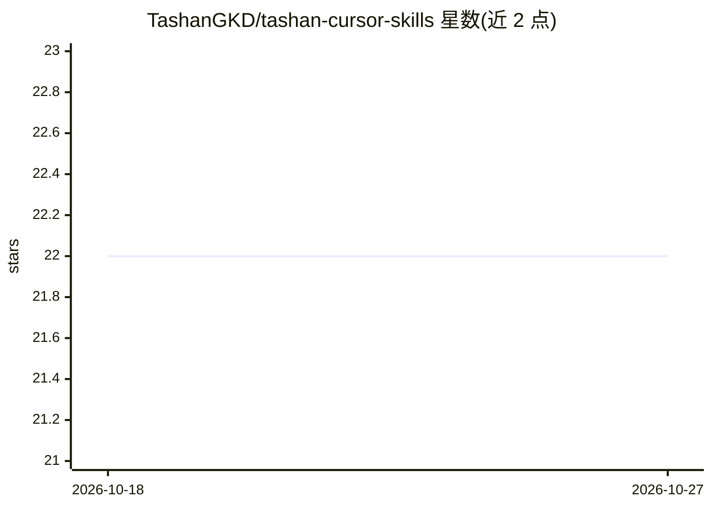

# TashanGKD/tashan-cursor-skills

⭐ 22 · Shell · MIT · 推送 2026-04-01 · [GitHub](https://github.com/TashanGKD/tashan-cursor-skills) · 个人维护 · 中文 README

**面向 Cursor 的自进化 Agent Skill 体系（95 Skills/32 Rules/18 SubAgents）**

为 Cursor AI 编辑器构建的执行套具（Agent Harness）体系：由 Skills、Rules、SubAgents 三层组成，覆盖产品开发全链路角色、质量关卡、Bug 修复闭环、内容创作、认知积累、数字分身等类别。核心机制是任务完成后的 D5 信号自动路由：踩坑追加为 Skill 警告、洞见沉淀为认知碎片、流程缺口生成待建 Skill，形成三层同步更新的自我进化闭环。通过 npx CLI 或 Cursor 内置 GitHub 导入安装。

## 筛选速览

| 维度 | 判定 | 备注 |
|---|---|---|
| AI 角色 | `ai-ecosystem` | LLM/agent 周边工具 |
| 许可风险 | `permissive` | MIT |
| 部署形态 | `library` | 以包/库形式分发 |
| 模型依赖 | — | README 未给出锁定关系 |
| 硬件要求 | — | 无带数字的原话,不猜 |
| 安装摩擦 | `low` | 无编译、无系统依赖或容器化 |
| 成熟度 | — | 结构信号不足 |

## 能力要点

- Skills/Rules/SubAgents 三层结构，六条通路构成自我进化闭环
- 任务后 D5 信号自动路由：踩坑/洞见/缺口分流到对应更新通道
- 质量关卡使用独立 SubAgent（readonly）做视角隔离验证
- 覆盖开发、测试、Bug 修复、内容创作、认知管理等 11 类 Skill

## 适用场景

- 在 Cursor 中按触发词自动路由到对应角色或 Skill 执行开发任务
- 让任务执行中的踩坑与洞见自动沉淀为 Skill 步骤与认知文档
- 通过批量复盘与健康检查维护 Skill 体系

## 场景标签

`Agent 框架` · 领域:Agent 开发

## 证据(README 行号)

> L5:  他山 Cursor Skill 体系
> L36: 这套体系围绕一个核心机制构建：**执行中涌现的经验，自动更新 Harness 本身。**
> L500: - 触发词命中，对应 SKILL.md 被读入 context，AI 按步骤执行
> L514: npx ai-agent-skills install TashanGKD/tashan-cursor-skills

## 星数曲线

2026-10-18 22 → 2026-10-27 22（+0）

---
*卡片 v1 · prompt 1.4 · 生成 2026-10-27 · 置信度 high · 依据 README sha `1a019b071bdf` · [字段定义](../../DATASET.md)*
