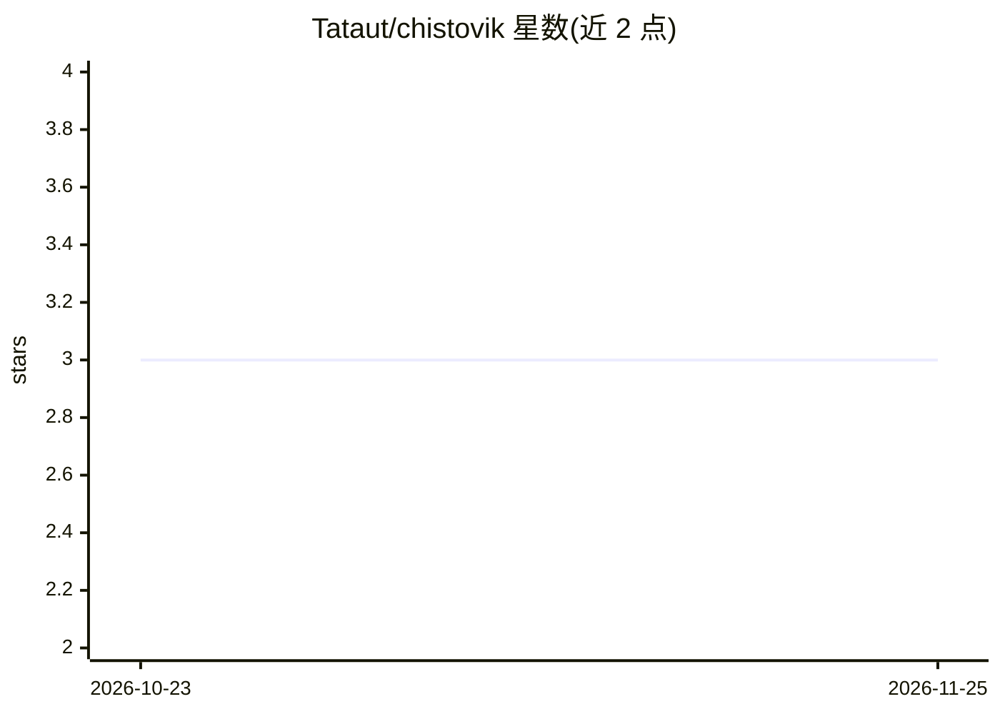

# Tataut/chistovik

⭐ 3 · Python · MIT · 推送 2026-10-12 · [GitHub](https://github.com/Tataut/chistovik) · 个人维护

**俄语听写清理中继：让 Windows 任意应用里粘贴干净文本**

一个单文件 Python 中继程序（仅标准库），部署在开源听写应用 Handy 与 OpenAI 兼容 API 之间：Handy 本地用 Whisper 转录语音后，把转写文本发给 Chistovik，由 LLM 清除口头语、假起头、重复并补全标点，再粘贴回光标处。维护两个每次听写时重新读取的文本文件——prompt.txt（清理规则）与 dictionary.txt（俄语专有词修正表）；另保留常驻 HTTP 连接、在本目录保存 API key、10 秒超时后回退输出原始转写。安装脚本仅限 Windows，程序本体跨平台。

## 筛选速览

| 维度 | 判定 | 备注 |
|---|---|---|
| AI 角色 | `ai-native` | 本体是模型或模型工具 |
| 许可风险 | `permissive` | MIT |
| 部署形态 | `None` |  |
| 模型依赖 | locked-api |  |
| 硬件要求 | — | 无带数字的原话,不猜 |
| 安装摩擦 | `low` | 无编译、无系统依赖或容器化 |
| 成熟度 | — | 结构信号不足 |

## 能力要点

- 单文件 Python 中继，仅标准库，无第三方依赖
- 每次听写热重载 prompt.txt 与 dictionary.txt，改完即生效
- 上下文感知词典修正俄语专有词，非简单查找替换
- 仅监听 localhost，音频本地转录不出机

## 适用场景

- 在 Windows 上向任意应用口述俄语，得到可直接粘贴的书面文本
- 与 Claude/OpenAI/OpenRouter 或本地模型配合做语音转写后处理
- 给语音识别建自定义俄语词表（姓名、俚语）

## 场景标签

 · 领域:语音听写/桌面效率工具

## 证据(README 行号)

> L3: **Clean Russian dictation for any Windows app.** Speak the way you talk; get text as if you had typed it: no «ну», «
> L44: - **Handy** is a free, open-source dictation app. Hold a hotkey, speak, release, and the text appears where your cu
> L45: - **Chistovik** is a small relay between Handy and the model: one Python file, standard library only. Handy talks t

## 星数曲线

2026-10-23 3 → 2026-11-25 3（+0）

---
*卡片 v1 · prompt 1.4 · 生成 2026-11-22 · 置信度 high · 依据 README sha `93bf72abac82` · [字段定义](../../DATASET.md)*
