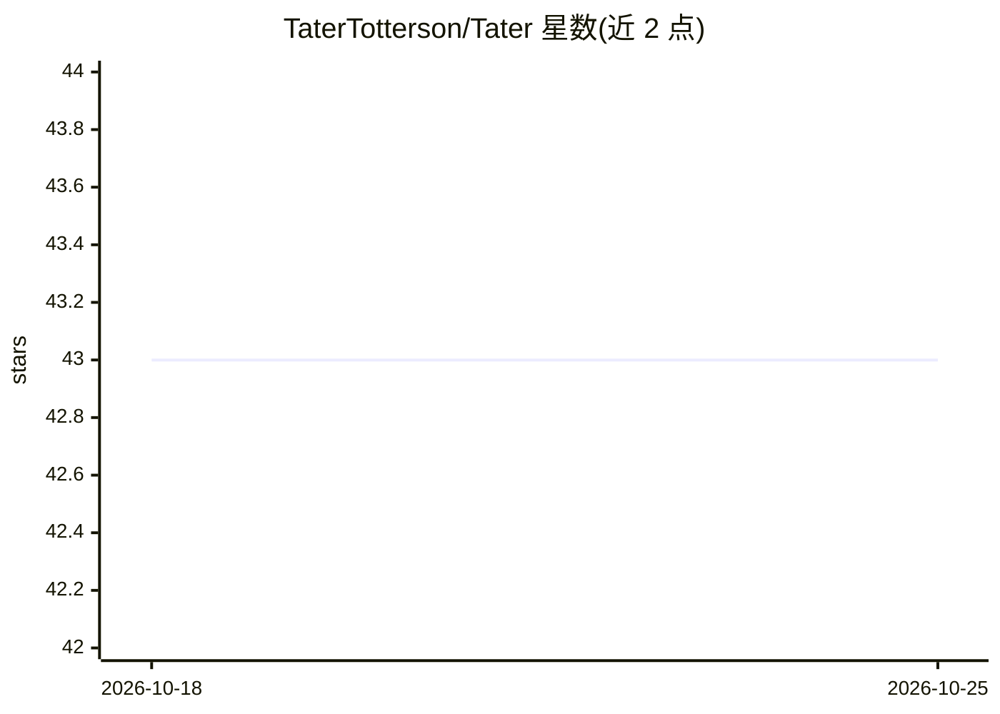

# TaterTotterson/Tater

⭐ 43 · Python · AGPL-3.0 · 推送 2026-10-25 · [GitHub](https://github.com/TaterTotterson/Tater) · [官网](https://taterassistant.com) · 个人维护

**本地自托管的个人 AI 助手平台，替代 Siri/Alexa**

本地优先的 AI 助手平台：通过 llama.cpp、Hugging Face Transformers、MLX 运行本地模型，或连接 Ollama、LM Studio、LocalAI、vLLM 等 OpenAI 兼容 API。功能覆盖语音（多款语音卫星硬件）、视觉、记忆、自动化、智能家居（Home Assistant/HomeKit）、音乐与消息，并提供 Discord、IRC、Matrix、Telegram 等平台入口。模块化架构由 Cores/Portals/Verbas/Integrations 组成，经 Tater Shop 管理目录与更新。提供 macOS 应用、Home Assistant 插件、Unraid 一键安装、Docker 与本地安装多种途径。

## 筛选速览

| 维度 | 判定 | 备注 |
|---|---|---|
| AI 角色 | `ai-native` | 本体是模型或模型工具 |
| 许可风险 | `viral` | AGPL-3.0 |
| 部署形态 | `self-host` | docker 或自建部署 |
| 模型依赖 | local-ok | 支持本地模型 |
| 硬件要求 | — | 无带数字的原话,不猜 |
| 安装摩擦 | `low` | 无编译、无系统依赖或容器化 |
| 成熟度 | — | 结构信号不足 |

## 能力要点

- 内置 llama.cpp GGUF、Hugging Face Transformers、MLX 三种本地模型引擎，另支持 OpenAI 兼容 API
- 接入 Discord、Home Assistant、HomeKit、IRC、Matrix、Telegram 等平台入口
- 支持 VoicePE、Sat1、S3Box、ReSpeaker XVF3800 等语音卫星硬件及 Reachy Mini 机器人
- Tater Bench 提供跨引擎与硬件的本地模型可重复评测

## 适用场景

- 在自有硬件上搭建替代 Siri/Alexa 的私人语音助手
- 统一管理智能家居、消息与自动化并通过对话调用
- 在树莓派、Jetson、Apple Silicon 等多种本地硬件上运行本地模型

## 场景标签

`AI 助手` `语音 Agent` `工作流自动化` · 领域:效率与自动化

## 证据(README 行号)

> L9: **Tater** is a local-first AI platform that can run local models through **llama.cpp**, **Hugging Face Transformers*
> L2:  Tater AI Assistant

## 星数曲线

2026-10-18 43 → 2026-10-25 43（+0）

---
*卡片 v1 · prompt 1.4 · 生成 2026-10-25 · 置信度 high · 依据 README sha `aa1706f5948e` · [字段定义](../../DATASET.md)*
