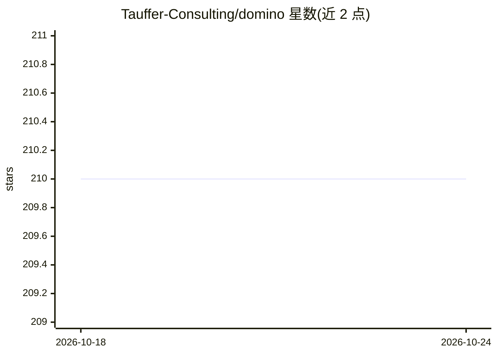

# Tauffer-Consulting/domino

⭐ 210 · Python · Apache-2.0 · 推送 2026-03-06 · [GitHub](https://github.com/Tauffer-Consulting/domino) · 组织维护

**开源工作流管理平台：GUI 拖拽编排数据处理与机器学习流水线**

面向数据与机器学习工程的开源工作流管理平台。前端为 React GUI，用户在画布上拖拽连接可复用的功能单元 Pieces 组成工作流，支持周期/定时/手动调度与实时监控（状态、日志、结果）。每个工作流对应一个 Apache Airflow DAG，由后端 REST API（FastAPI）控制 Airflow 实例执行调度。Pieces 以 Git 仓库形式分发安装，运行在隔离的 Docker 容器中且不可变以保证可复现。本地开发可经 pip 安装 CLI 后用 Docker Compose 启动，生产环境推荐 Kubernetes 部署；由 Tauffer Consulting 公司维护。

## 筛选速览

| 维度 | 判定 | 备注 |
|---|---|---|
| AI 角色 | `ai-ecosystem` | LLM/agent 周边工具 |
| 许可风险 | `permissive` | Apache-2.0 |
| 部署形态 | `self-host` | docker 或自建部署 |
| 模型依赖 | — | README 未给出锁定关系 |
| 硬件要求 | — | 无带数字的原话,不猜 |
| 安装摩擦 | `low` | 无编译、无系统依赖或容器化 |
| 成熟度 | — | 结构信号不足 |

## 能力要点

- GUI 拖拽编排工作流，实时监控每个 Piece 的状态、日志与结果
- 每个工作流映射为 Airflow DAG，后端 REST API 控制 Airflow 实例
- Pieces 为可从 GitHub 仓库安装的可复用功能单元，运行在隔离 Docker 容器中且不可变
- 支持 Kubernetes 原生部署与工作流内任务共享存储

## 适用场景

- 用图形界面编排数据处理或机器学习流水线而不用写 DAG 代码
- 团队协作创建、编辑和监控周期性运行的工作流
- 复用和分享他人发布的 Pieces 快速搭建流水线

## 场景标签

`工作流自动化` · 领域:效率与自动化

## 证据(README 行号)

> L29: - :desktop_computer: an intuitive Graphical User Interface that facilitates creating, editing and monitoring any ty
> L37: Every Domino Workflow corresponds to an Apache Airflow DAG, and each Piece corresponds to an Airflow task. Domino c

## 星数曲线

2026-10-18 210 → 2026-10-24 210（+0）

---
*卡片 v1 · prompt 1.4 · 生成 2026-10-22 · 置信度 high · 依据 README sha `5c4286052448` · [字段定义](../../DATASET.md)*
