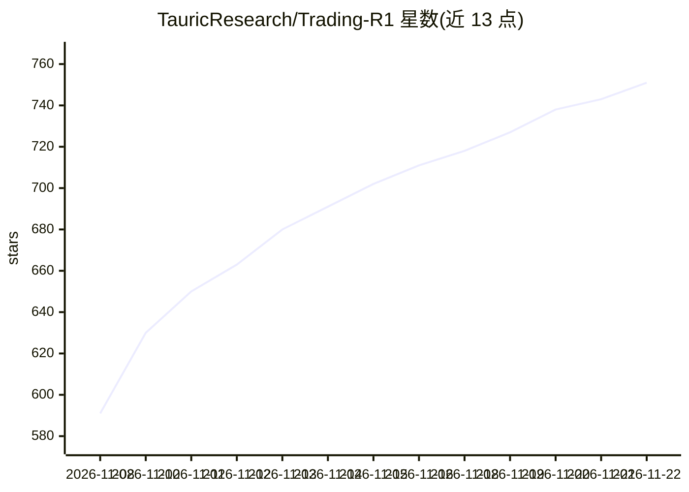

# TauricResearch/Trading-R1

⭐ 751 · Python · Apache-2.0 · 推送 2026-11-20 · [GitHub](https://github.com/TauricResearch/Trading-R1) · [官网](https://tauric.ai) · 组织维护

**面向金融研究的终端 Agent：用 LLM 回答研究问题并生成报告**

命令行终端应用，用 LLM agent 做金融研究与数据分析：支持 auto/research/analytical 三种模式，agent 调用网络、数据与估值工具回答研究问题；回答可导出为 PDF/Markdown 报告，发送至 Telegram、email 或文件夹，支持定时任务（如每日晨报）与后台守护服务，Telegram 频道可双向问答。模型可选 Tauric、OpenAI、Anthropic、Gemini 或自建 vLLM 服务器，需相应 API key。仅供研究与教育用途，非投资建议，Apache-2.0 许可。

## 筛选速览

| 维度 | 判定 | 备注 |
|---|---|---|
| AI 角色 | `ai-native` | 本体是模型或模型工具 |
| 许可风险 | `permissive` | Apache-2.0 |
| 部署形态 | `library` | 以包/库形式分发 |
| 模型依赖 | local-ok | 支持本地模型 |
| 硬件要求 | — | 无带数字的原话,不猜 |
| 安装摩擦 | `low` | 无编译、无系统依赖或容器化 |
| 成熟度 | — | 结构信号不足 |

## 能力要点

- auto/research/analytical 三种模式，agent 自主决定工具使用
- 报告导出 PDF/Markdown 并发送 Telegram、email、文件夹
- 定时任务与 systemd/launchd 后台服务，Telegram 支持从手机提问
- 支持 Tauric/OpenAI/Anthropic/Gemini/自建 vLLM 多种模型

## 适用场景

- 在终端里向 AI 提问并获取股票研究问答
- 设置每日定时晨报并发送到 Telegram 或邮箱
- 用自建 vLLM 服务器离线运行金融研究 agent

## 场景标签

`金融量化` `数据分析` · 领域:效率与自动化

## 证据(README 行号)

> L22:  Trading-R1: The terminal for financial research and analysis
> L70: trading-r1 "What's NVDA's last quarterly revenue?"  # and ask a first question

## 星数曲线

2026-11-08 591 → 2026-11-22 751（+160）

---
*卡片 v1 · prompt 1.4 · 生成 2026-11-17 · 置信度 high · 依据 README sha `f0c968dd27b3` · [字段定义](../../DATASET.md)*
