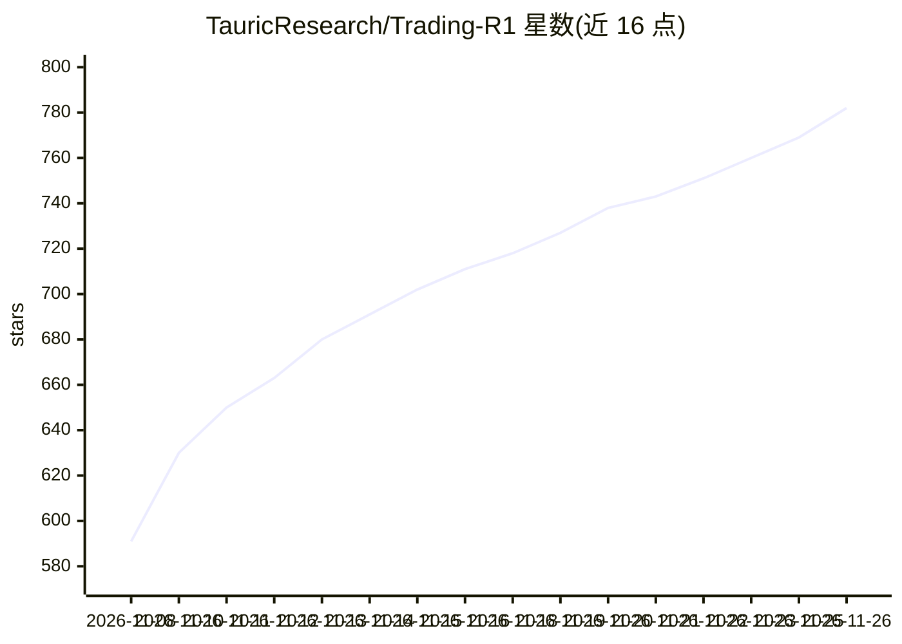

# TauricResearch/Trading-R1

⭐ 782 · Python · Apache-2.0 · 推送 2026-11-25 · [GitHub](https://github.com/TauricResearch/Trading-R1) · [官网](https://arxiv.org/pdf/2509.11420) · 组织维护 · 中文 README

**面向金融研究者的终端 AI 研究分析工具**

一个终端形态的金融研究与分析工具：用户以自然语言提问（如某公司季度营收），由 agent 调用数据、估值与网络检索工具完成研究并生成报告。提供 auto/research/analytical 三种模式、命令面板、多模型选择（OpenAI/Anthropic/Gemini/Tauric/vLLM 后端）、PDF/Markdown 报告导出、Telegram 与邮件渠道发送、定时报告任务及 systemd/launchd 后台服务。声明仅限研究与教育用途，非投资建议。

## 筛选速览

| 维度 | 判定 | 备注 |
|---|---|---|
| AI 角色 | `ai-native` | 本体是模型或模型工具 |
| 许可风险 | `permissive` | Apache-2.0 |
| 部署形态 | `library` | 以包/库形式分发 |
| 模型依赖 | local-ok | 支持本地模型 |
| 硬件要求 | — | 无带数字的原话,不猜 |
| 安装摩擦 | `low` | 无编译、无系统依赖或容器化 |
| 成熟度 | — | 结构信号不足 |

## 能力要点

- 终端内自然语言金融研究问答，agent 自动调用数据与估值工具
- auto/research/analytical 三种模式与命令面板
- 报告导出 PDF/Markdown，可经 Telegram/email/folder 发送
- 定时报告任务与 systemd/launchd 后台服务

## 适用场景

- 在终端里直接提问个股财务数据并获得研究报告
- 设置每日定时任务自动生成关注标的晨报并发送到 Telegram/邮箱
- 将研究结论导出为 PDF 报告存档或分享

## 场景标签

`金融量化` · 领域:学习与行业

## 证据(README 行号)

> L23:  Trading-R1: The terminal for financial research and analysis
> L71: trading-r1 "What's NVDA's last quarterly revenue?"  # and ask a first question
> L85: |`auto`|Full toolkit; the agent decides|

## 星数曲线

2026-11-08 591 → 2026-11-26 782（+191）

---
*卡片 v1 · prompt 1.4 · 生成 2026-11-24 · 置信度 high · 依据 README sha `9c976b7859a3` · [字段定义](../../DATASET.md)*
