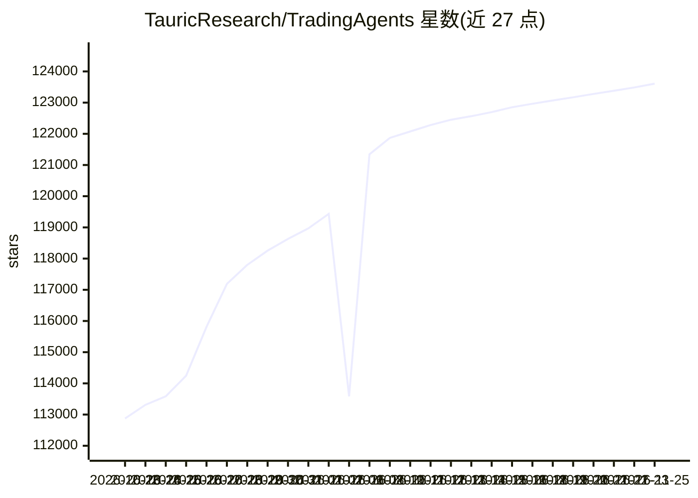

# TauricResearch/TradingAgents

⭐ 123,607 · Python · Apache-2.0 · 推送 2026-11-17 · [GitHub](https://github.com/TauricResearch/TradingAgents) · [官网](https://tauric.ai) · 组织维护

**多智能体 LLM 金融交易研究框架：分析师辩论生成交易决策**

模拟真实交易公司分工的多智能体框架：由基本面、情绪、新闻、技术四类分析师并行产出报告，多空研究员结构化辩论，交易员决定交易时机与规模，风控团队与组合经理在模拟交易所完成最终裁决。设计定位为研究用途，声明不构成投资建议，回测采用 point-in-time 数据一致性约束避免前视偏差。提供 CLI 交互与免提问的 flag 脚本模式、LangGraph 检查点恢复、Docker 运行方式，支持 ChatGPT Plus/Pro 订阅登录运行。

## 筛选速览

| 维度 | 判定 | 备注 |
|---|---|---|
| AI 角色 | `ai-native` | 本体是模型或模型工具 |
| 许可风险 | `permissive` | Apache-2.0 |
| 部署形态 | `self-host` | docker 或自建部署 |
| 模型依赖 | local-ok | 支持本地模型 |
| 硬件要求 | — | 无带数字的原话,不猜 |
| 安装摩擦 | `low` | 无编译、无系统依赖或容器化 |
| 成熟度 | `idea` | |

## 动量与使用信号

- 维护:`active` — 距上次 push 1.4 天,年发版 14,23 位贡献者
- 涨星:近 1 天 **+244**(自 20261016 起算)
- 平台:WINDOWS · 协议:OPENAI-API / OLLAMA

## 能力要点

- 分析师/研究员/交易员/风控的多角色 LLM 智能体协作与辩论
- 并行分析师与 LangGraph 检查点恢复、持久决策日志
- 多 provider 接入：API key、ChatGPT 订阅登录、Ollama 本地模型、OpenAI 兼容端点
- 回测的 point-in-time 数据完整性约束与模拟交易所执行

## 适用场景

- 对指定股票代码运行多智能体分析并生成交易决策报告
- 在 ticker/日期网格上做回测研究
- 用本地 Ollama 或自建 vLLM 端点跑离线研究流程
- 通过 CLI flag 定时调度无交互分析任务

## 场景标签

`多智能体` `金融量化` · 领域:Agent 开发

## 证据(README 行号)

> L50: TradingAgents is a multi-agent trading framework that mirrors the dynamics of real-world trading firms. By deployin
> L52: > TradingAgents framework is designed for research purposes. Trading performance may vary based on many factors, in
> L74: ## Installation and CLI

## 星数曲线

2026-10-23 112,875 → 2026-11-25 123,607（+10,732）

---
*卡片 v1 · prompt 1.4 · 生成 2026-11-22 · 置信度 high · 依据 README sha `42819fc94665` · [字段定义](../../DATASET.md)*
