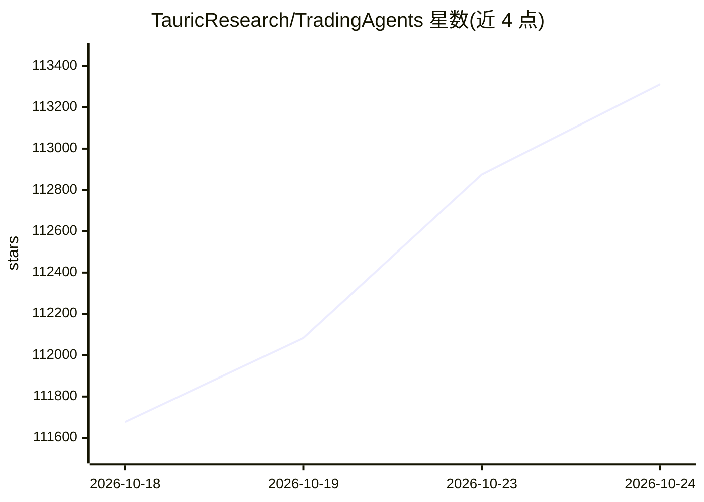

# TauricResearch/TradingAgents

⭐ 113,583 · Python · Apache-2.0 · 推送 2026-10-16 · [GitHub](https://github.com/TauricResearch/TradingAgents) · [官网](https://arxiv.org/pdf/2412.20138) · 组织维护

**多智能体 LLM 金融交易研究框架：模拟交易公司角色分工**

以真实交易公司组织方式组织 LLM 智能体：分析师团队（基本面/情绪/新闻/技术四类）、多空研究员辩论、交易员决策、风控与组合经理审批，最终在模拟交易所执行。支持多 LLM 提供商、CLI 交互与无终端参数化运行、回测、LangGraph checkpoint 续跑、HTML 报告导出。README 明确声明仅供研究用途，不构成投资建议；运行受所选模型、温度、数据质量等因素影响。

## 筛选速览

| 维度 | 判定 | 备注 |
|---|---|---|
| AI 角色 | `ai-native` | 本体是模型或模型工具 |
| 许可风险 | `permissive` | Apache-2.0 |
| 部署形态 | `self-host` | docker 或自建部署 |
| 模型依赖 | local-ok | 支持本地模型 |
| 硬件要求 | — | 无带数字的原话,不猜 |
| 安装摩擦 | `low` | 无编译、无系统依赖或容器化 |
| 成熟度 | — | 结构信号不足 |

## 动量与使用信号

- 维护:`active` — 距上次 push 1.4 天,年发版 14,23 位贡献者
- 涨星:近 1 天 **+244**(自 20261016 起算)
- 平台:WINDOWS · 协议:OPENAI-API / OLLAMA

## 能力要点

- 分析师/研究员/交易员/风控/组合经理的多智能体协作与辩论机制
- 多 LLM 提供商：OpenAI、Gemini、Claude、Bedrock、Ollama 及任意 OpenAI 兼容端点
- 可用 ChatGPT Plus/Pro 订阅计划运行，无需单独 API key
- CLI 支持 ticker/date 等参数免交互运行与 HTML 单页报告输出

## 适用场景

- 对特定股票在指定日期运行多智能体分析并生成报告
- 用回测网格按 ticker 与日期验证策略表现
- 通过 Ollama/vLLM 等本地模型端点运行分析流程

## 场景标签

`多智能体` `金融量化` · 领域:Agent 开发

## 证据(README 行号)

> L51: TradingAgents is a multi-agent trading framework that mirrors the dynamics of real-world trading firms. By deployin
> L53: > TradingAgents framework is designed for research purposes. Trading performance may vary based on many factors, in
> L121: TradingAgents supports multiple LLM providers. Set the API key for your chosen provider:

## 星数曲线

2026-10-18 111,677 → 2026-10-24 113,311（+1,634）

---
*卡片 v1 · prompt 1.4 · 生成 2026-10-18 · 置信度 high · 依据 README sha `3d1cf6b1a659` · [字段定义](../../DATASET.md)*
