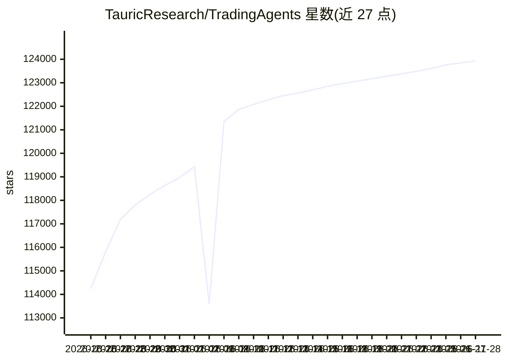

# TauricResearch/TradingAgents

⭐ 123,933 · TypeScript · Apache-2.0 · 推送 2026-11-25 · [GitHub](https://github.com/TauricResearch/TradingAgents) · [官网](https://tauric.ai) · 组织维护 · 中文 README

**终端金融研究 Agent：提问后给出带来源标注的研究答案**

以终端 CLI 形式运行的金融研究 Agent：用户输入问题，主 Agent 制定研究计划、调用数据与计算工具，并向权益研究、宏观策略、量化研究、风险分析等专职 Agent 咨询，产出带来源编号的答案，可导出为 PDF 报告或 Markdown。支持自述的 agents 与 skills 扩展（Markdown 文件）。限制：仅做研究与回答，不执行交易；多数 Provider 需 API key。

## 筛选速览

| 维度 | 判定 | 备注 |
|---|---|---|
| AI 角色 | `ai-native` | 本体是模型或模型工具 |
| 许可风险 | `permissive` | Apache-2.0 |
| 部署形态 | `library` | 以包/库形式分发 |
| 模型依赖 | local-ok | 支持本地模型 |
| 硬件要求 | — | 无带数字的原话,不猜 |
| 安装摩擦 | `low` | 无编译、无系统依赖或容器化 |
| 成熟度 | — | 结构信号不足 |

## 动量与使用信号

- 维护:`active` — 距上次 push 1.4 天,年发版 14,23 位贡献者
- 涨星:近 1 天 **+244**(自 20261016 起算)
- 平台:WINDOWS · 协议:OPENAI-API / OLLAMA

## 能力要点

- 主 Agent 分派任务给权益/宏观/量化/风险四类专职 Agent（各自独立上下文）
- 答案中每个数字标注来源，并附编号来源列表
- 按公司/估值/市场/风险提供内置研究 skills，可用 Markdown 自定义扩展
- 支持 /model 选择模型与推理强度、/resume 恢复会话、/export 导出报告

## 适用场景

- 在终端里向 Agent 提问并获取带出处的公司基本面研究
- 生成收益预览、DCF 估值、技术分析等结构化研究报告
- 对持仓做风险评估与组合回顾，并导出 PDF 报告

## 场景标签

`金融量化` · 领域:学习与行业

## 证据(README 行号)

> L66: Type a question and press Enter. Every figure in the answer is marked with its source, and a numbered list of
> L86: The main agent plans the research, reads what the question needs with its data tools, and works the numbers
> L106: and answers; it does not place trades.

## 星数曲线

2026-10-26 114,247 → 2026-11-28 123,933（+9,686）

---
*卡片 v1 · prompt 1.4 · 生成 2026-11-26 · 置信度 high · 依据 README sha `c7d60b6fc387` · [字段定义](../../DATASET.md)*
