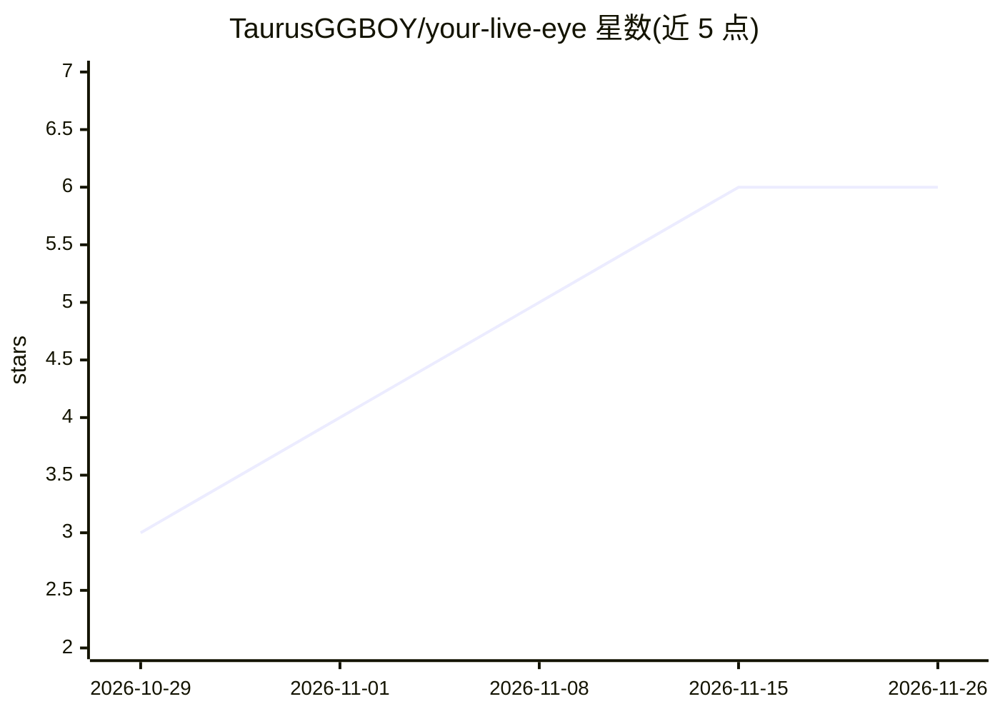

# TaurusGGBOY/your-live-eye

⭐ 6 · Python · MIT · 推送 2026-10-27 · [GitHub](https://github.com/TaurusGGBOY/your-live-eye) · [官网](https://your-live-eye-demo.pages.dev/) · 个人维护 · 中文 README

**面向 Agent 的 B 站直播弹幕分类分析与页面生成工具**

输入 B 站 UP 主的 UID、昵称或链接，从公开直播档案（默认 Danmakus 来源）下载已结束场次的弹幕，经去重后批量调用模型完成八类分类（翻译、招呼、支持、玩梗、闲聊、争吵、待判断、关心）、争吵措辞强度评分与玩梗复核，生成静态分析页面并支持局域网或 Cloudflare Pages 部署与每日定时更新。默认通过已登录的 Codex CLI 调用模型，需要 Python 3.11+ 与可用模型权限。不是实时采集器，仅分析有公开档案的历史直播。

## 筛选速览

| 维度 | 判定 | 备注 |
|---|---|---|
| AI 角色 | `ai-native` | 本体是模型或模型工具 |
| 许可风险 | `permissive` | MIT |
| 部署形态 | `library` | 以包/库形式分发 |
| 模型依赖 | — | README 未给出锁定关系 |
| 硬件要求 | — | 无带数字的原话,不猜 |
| 安装摩擦 | `low` | 无编译、无系统依赖或容器化 |
| 成熟度 | — | 结构信号不足 |

## 能力要点

- 内置 your-live-eye-setup 初始化 Skill，Agent 可确认主播、模式、模型与部署配置后执行
- 八类弹幕分类加争吵 1–100 分措辞强度评分，玩梗含原文依据与独立复核
- 支持 Cloudflare Pages 部署、R2 状态存储断点续跑与北京时间定时日更
- 导出目录仅含页面与匿名展示数据，原始归档与回执留在独立 STATE 目录

## 适用场景

- 把某个 UP 主的直播弹幕分析任务一句话交给 Agent 完成
- 为直播间的弹幕声音生成可公开访问的分类页面
- 配置每日自动补齐新场次并发布更新

## 场景标签

`数据分析` · 领域:效率与自动化

## 证据(README 行号)

> L13: 给 Agent 一个 B 站 UP 主的 **UID、昵称或链接**，从公开直播档案生成分类页面，并完成局域网或 Cloudflare 部署和每日更新。
> L58: 入口自动建立独立 Python 环境并安装依赖，随后执行：身份解析 → 全部已结束历史直播 → 原始归档 → 直播边界过滤 → 括号规则 → 去重文本批量分类 → 独立强度评分 → 玩梗语义初审与独立复核 → 数据对账 → 静态页
> L108: - `【` 或 `】` 字面格式直接归翻译；其余批量调用模型。八类包括翻译、招呼、支持、玩梗、闲聊、争吵、待判断、关心。

## 星数曲线

2026-10-29 3 → 2026-11-26 6（+3）

---
*卡片 v1 · prompt 1.4 · 生成 2026-11-20 · 置信度 high · 依据 README sha `367093e7b14f` · [字段定义](../../DATASET.md)*
