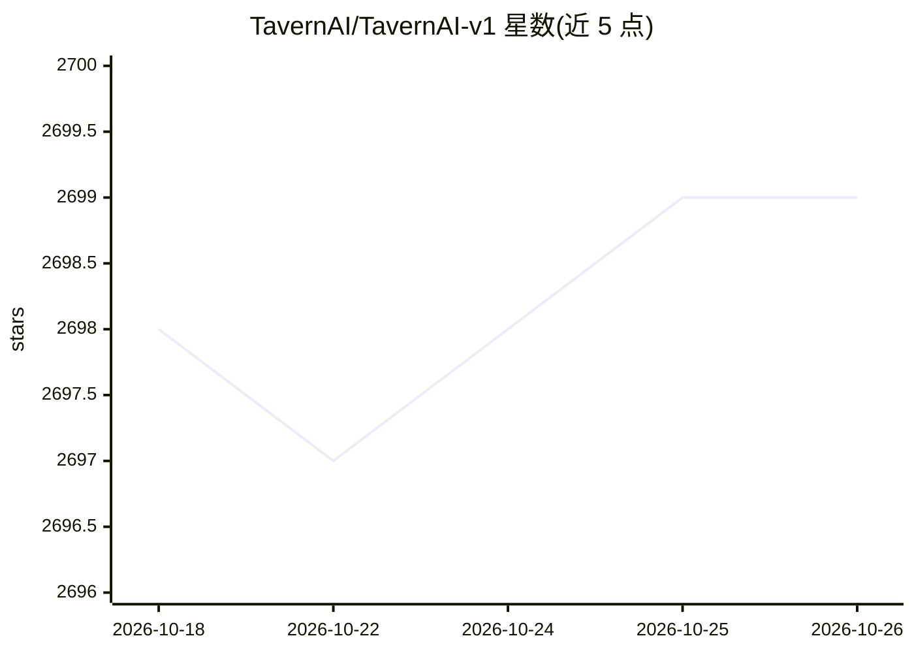

# TavernAI/TavernAI-v1

⭐ 2,699 · JavaScript · MIT · 推送 2026-06-16 · [GitHub](https://github.com/TavernAI/TavernAI-v1) · [官网](https://tavernai.net) · 个人维护

**面向用户与 AI 语言模型对话和写作的前端界面**

TavernAI 是一个聊天与故事写作的前端，通过连接多种后端（KoboldAI/KoboldCpp/Horde、Oobabooga、OpenAI、NovelAI、Claude、Ollama）与语言模型交互。功能包括角色创建、在线角色库、多角色群聊、故事模式、世界书、消息编辑与图片识别等。提供 Windows .exe、Node.js 源码运行和 Google Colab 在线方式。注意：本仓库为遗留版本，TavernAI 2 已另立仓库。

## 筛选速览

| 维度 | 判定 | 备注 |
|---|---|---|
| AI 角色 | `ai-ecosystem` | LLM/agent 周边工具 |
| 许可风险 | `permissive` | MIT |
| 部署形态 | `desktop` | 安装包/桌面程序 |
| 模型依赖 | local-ok | 支持本地模型 |
| 硬件要求 | — | 无带数字的原话,不猜 |
| 安装摩擦 | `low` | 无编译、无系统依赖或容器化 |
| 成熟度 | — | 结构信号不足 |

## 能力要点

- 支持 Kobold 系列、OpenAI、NovelAI、Claude、Ollama 等多种后端
- 角色创建、在线角色库与多角色群聊
- 故事模式、世界信息与可配置生成参数
- 提供 Windows .exe 与 Google Colab 在线运行方式

## 适用场景

- 用一个界面连接不同后端与 AI 角色对话
- 进行多角色群聊或交互式故事写作
- 在没有本地部署的设备上通过 Colab 使用

## 场景标签

`聊天机器人` `AI 写作` · 领域:对话与助手

## 证据(README 行号)

> L2: ### TavernAI is an atmospheric frontend for chat and storywriting, compatible with many backends!
> L42: ## Supported Backends

## 星数曲线

2026-10-18 2,698 → 2026-10-26 2,699（+1）

---
*卡片 v1 · prompt 1.4 · 生成 2026-10-21 · 置信度 high · 依据 README sha `f66261cbe748` · [字段定义](../../DATASET.md)*
