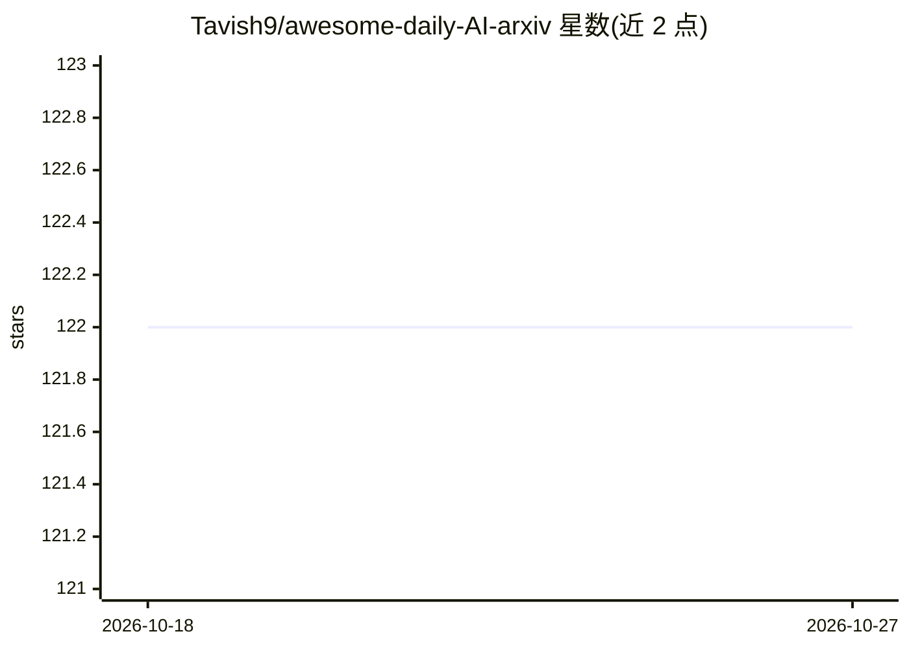

# Tavish9/awesome-daily-AI-arxiv

⭐ 122 · Python · NOASSERTION · 推送 2026-10-26 · [GitHub](https://github.com/Tavish9/awesome-daily-AI-arxiv) · 个人维护 · 中文 README

**AI/NLP/CV/机器人领域 arXiv 论文每日摘要清单**

自动化维护的 arXiv 论文日报仓库：通过 arXiv API 抓取 AI、NLP、CV、ML、Robotics 等类别的论文，每日 UTC 02:00 定时更新，按类别组织全文存档（如 AI 86 篇、CV 169 篇等），条目含标题、arXiv 编号、作者与摘要。首页提供热点主题（Benchmark/LLM/Test-Time-Scaling 等）导航，供研究者跟踪新论文。内容为生成清单而非可安装软件。

## 筛选速览

| 维度 | 判定 | 备注 |
|---|---|---|
| AI 角色 | `ai-knowledge` | 知识聚合/清单类 |
| 许可风险 | `none` | NOASSERTION |
| 部署形态 | `None` |  |
| 模型依赖 | — | README 未给出锁定关系 |
| 硬件要求 | — | 无带数字的原话,不猜 |
| 安装摩擦 | `low` | 无编译、无系统依赖或容器化 |
| 成熟度 | — | 结构信号不足 |

## 能力要点

- 每日定时（UTC 02:00）通过 arXiv API 更新论文条目
- 按 6 个 arXiv 类别组织全文存档并计数
- 条目含标题、arXiv 编号、作者与摘要
- 提供热点主题与活跃平台导航

## 适用场景

- 每日浏览 AI/NLP/CV/机器人领域新论文
- 按类别查找近期 arXiv 论文摘要
- 跟踪 Benchmark、LLM、Embodied AI 等热点方向

## 场景标签

`精选清单` `科研工具` · 领域:学习与行业

## 证据(README 行号)

> L8: 📌 ​**Tracking Breakthroughs in**: `AI` • `NLP` • `CV` • `ML` • `Robotics`
> L31: |Category|Count|
> L44: - **Charts as Epistemic Actions for Experience-Driven Agentic Data Analysis** `arXiv:2610.30072`

## 星数曲线

2026-10-18 122 → 2026-10-27 122（+0）

---
*卡片 v1 · prompt 1.4 · 生成 2026-10-23 · 置信度 high · 依据 README sha `d03aa2641663` · [字段定义](../../DATASET.md)*
