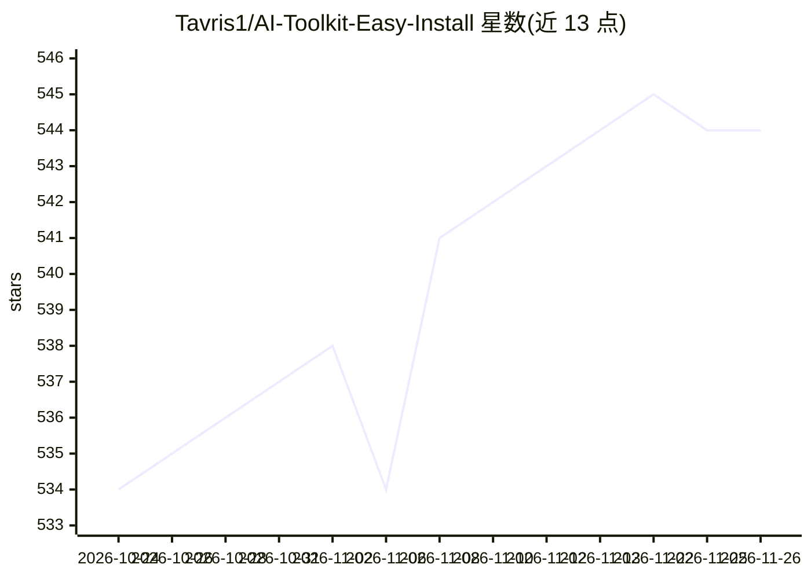

# Tavris1/AI-Toolkit-Easy-Install

⭐ 544 · Batchfile · MIT · 推送 2026-11-02 · [GitHub](https://github.com/Tavris1/AI-Toolkit-Easy-Install) · 个人维护

**为 Windows 用户提供 Ostris AI-Toolkit 的一键便携安装器**

将 Ostris 的 AI-Toolkit（图像与视频扩散模型训练套件）打包为 Windows 一键便携安装方案：通过 .bat 脚本自动安装/更新 Git、Node.js、FFmpeg 8、内嵌版 Python、PyTorch、Triton、FlashAttention 等组件，无需系统 Python 与虚拟环境。提供启动器：.bat 启动本地服务并打开浏览器、桌面快捷方式自动修复、一键更新与手动更新工具。仅面向 Windows 与 NVIDIA GPU，要求短英文路径与 v580+ 驱动。

## 筛选速览

| 维度 | 判定 | 备注 |
|---|---|---|
| AI 角色 | `ai-ecosystem` | LLM/agent 周边工具 |
| 许可风险 | `permissive` | MIT |
| 部署形态 | `None` |  |
| 模型依赖 | — | README 未给出锁定关系 |
| 硬件要求 | — | 无带数字的原话,不猜 |
| 安装摩擦 | `medium` | 含编译或系统依赖之一 |
| 成熟度 | — | 结构信号不足 |

## 能力要点

- 一键安装并组装 Git/Node.js/FFmpeg/内嵌 Python/PyTorch/Triton/FlashAttention 组件链
- 无需系统 Python 与 VENV 的便携式运行
- 启动器含一键更新（5 秒倒计时）与桌面快捷方式自动修复
- 提供 Update-AI-Toolkit 手动更新工具

## 适用场景

- 在 Windows 上快速部署 AI-Toolkit 训练环境
- 避免手动配置 Python 环境与依赖版本
- 需要便携式、可移动目录的本地训练套件

## 场景标签

`微调` · 领域:训练与推理

## 证据(README 行号)

> L3: One-click portable installer for "AI-Toolkit by Ostris"
> L4: An easy-to-use training suite for image and video diffusion models.
> L16: No system Python. No VENV. Just run and go.

## 星数曲线

2026-10-24 534 → 2026-11-26 544（+10）

---
*卡片 v1 · prompt 1.4 · 生成 2026-11-25 · 置信度 high · 依据 README sha `79c195d41674` · [字段定义](../../DATASET.md)*
