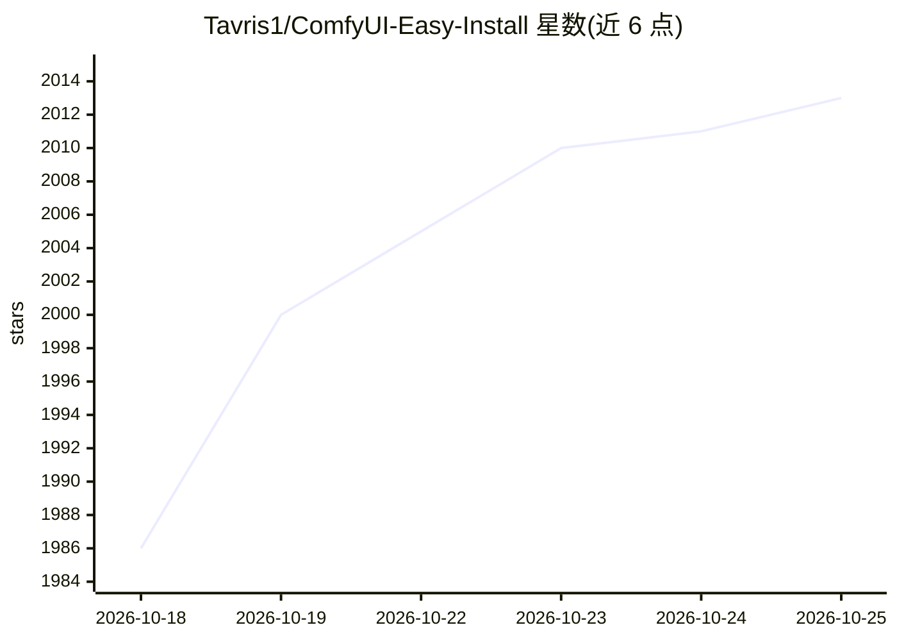

# Tavris1/ComfyUI-Easy-Install

⭐ 2,013 · Batchfile · MIT · 推送 2026-10-22 · [GitHub](https://github.com/Tavris1/ComfyUI-Easy-Install) · 个人维护

**Windows 一键便携安装 ComfyUI 的安装器，带 EZi Desktop 管理面板**

面向 ComfyUI 用户的便携式安装方案：下载 ZIP 解压后运行 ComfyUI-Easy-Install.bat 即可完成部署，无需手动配置 Python 与 Git；内置 Git、嵌入式 Python 与最新稳定版 ComfyUI。附带 EZi Desktop 面板，用于管理模型、包、PyTorch/CUDA 版本切换、VRAM 选项、GGUF 转换与缓存清理；支持一键安装 Nunchaku、SageAttention、FlashAttention、InsightFace 等复杂包。仅支持 Windows 与 NVIDIA GPU，随附 Pixaroma 教程所用节点集。

## 筛选速览

| 维度 | 判定 | 备注 |
|---|---|---|
| AI 角色 | `ai-ecosystem` | LLM/agent 周边工具 |
| 许可风险 | `permissive` | MIT |
| 部署形态 | `None` |  |
| 模型依赖 | — | README 未给出锁定关系 |
| 硬件要求 | — | 无带数字的原话,不猜 |
| 安装摩擦 | `medium` | 含编译或系统依赖之一 |
| 成熟度 | — | 结构信号不足 |

## 能力要点

- 免手动 Python/Git 配置的一键便携安装
- EZi Desktop 集中管理包、PyTorch/CUDA 版本与 GGUF 转换
- 一键安装 Nunchaku/SageAttention/FlashAttention/InsightFace 等复杂包
- 附 Easy-Models-Linker 复用已有模型目录，免重新下载

## 适用场景

- 在 Windows 上快速搭建可移植的 ComfyUI 环境
- 一站式管理 ComfyUI 的包、模型与版本切换
- 跟随 Pixaroma 教程时获得配套的节点与工具集

## 场景标签

 · 领域:AI 图像生成工具链/桌面工具

## 证据(README 行号)

> L17:  One-click Portable ComfyUI with EZi Desktop: a dashboard for packages, environments and configuration
> L34: **ComfyUI-Easy-Install** provides a portable ComfyUI environment with **EZi Desktop**.

## 星数曲线

2026-10-18 1,986 → 2026-10-25 2,013（+27）

---
*卡片 v1 · prompt 1.4 · 生成 2026-10-21 · 置信度 high · 依据 README sha `72c120db92f0` · [字段定义](../../DATASET.md)*
