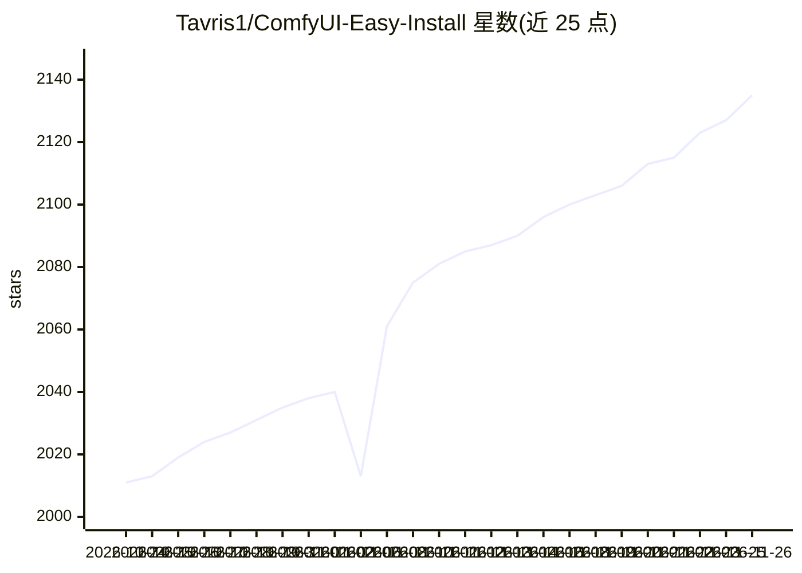

# Tavris1/ComfyUI-Easy-Install

⭐ 2,135 · PowerShell · MIT · 推送 2026-11-19 · [GitHub](https://github.com/Tavris1/ComfyUI-Easy-Install) · 个人维护 · 中文 README

**Windows 一键安装便携版 ComfyUI 的桌面管理器**

为 Windows 用户提供一键式便携 ComfyUI 安装：自动配置 Git、内嵌 Python 3.12、PyTorch+CUDA、ComfyUI 与 Pixaroma 教程所用节点包，并附带 EZi Desktop 桌面壳与 EZi Launcher。桌面端提供控制台、截图录屏、模型文件夹链接、启动参数编辑、版本管理、UV/PIP 缓存与快照恢复；另有 Nunchaku、SageAttention、FlashAttention、GGUF 转换等一键插件。要求 Windows 10/11 与 NVIDIA RTX 20 系列以上 GPU，卸载即删除文件夹。

## 筛选速览

| 维度 | 判定 | 备注 |
|---|---|---|
| AI 角色 | `ai-ecosystem` | LLM/agent 周边工具 |
| 许可风险 | `permissive` | MIT |
| 部署形态 | `None` |  |
| 模型依赖 | local-ok | 支持本地模型 |
| 硬件要求 | — | 无带数字的原话,不猜 |
| 安装摩擦 | `medium` | 含编译或系统依赖之一 |
| 成熟度 | — | 结构信号不足 |

## 能力要点

- 一键安装便携 ComfyUI（Git/Python/PyTorch/节点全自动配置）
- EZi Desktop 桌面窗口：控制台、启动参数、Dynamic VRAM、快照恢复
- 一键插件：Nunchaku、SageAttention、FlashAttention、InsightFace、GGUF 转换
- Torch-Pack 切换 PyTorch/CUDA 版本组合

## 适用场景

- 在 Windows 上一键装好 ComfyUI 并免去手动配环境
- 按 Pixaroma 教程使用的节点包快速搭建工作流
- 通过快照在更新前备份、出问题一键恢复

## 场景标签

`图像生成` `模型量化` · 领域:内容生成

## 证据(README 行号)

> L17:  One-click Portable ComfyUI with EZi Desktop - install, manage and customize ComfyUI in one place.
> L38: **ComfyUI-Easy-Install** installs a portable ComfyUI
> L41: - **One click** - Git, Python, PyTorch, ComfyUI and nodes are set up for you

## 星数曲线

2026-10-24 2,011 → 2026-11-26 2,135（+124）

---
*卡片 v1 · prompt 1.4 · 生成 2026-11-23 · 置信度 high · 依据 README sha `f5e94011c9d6` · [字段定义](../../DATASET.md)*
