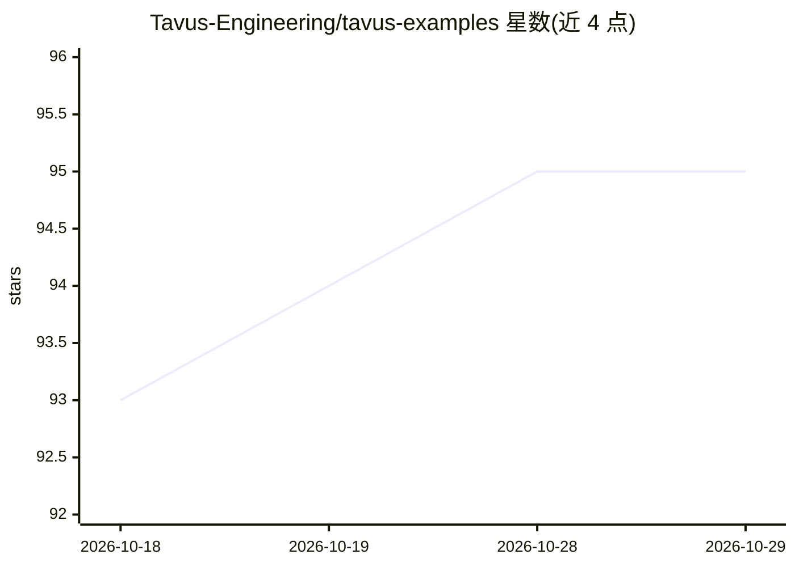

# Tavus-Engineering/tavus-examples

⭐ 95 · TypeScript · Apache-2.0 · 推送 2026-10-08 · [GitHub](https://github.com/Tavus-Engineering/tavus-examples) · [官网](https://docs.tavus.io/) · 组织维护

**Tavus 对话视频接口（CVI）与视频生成 API 的示例集**

Tavus 维护的官方示例仓库：提供 5 个 CVI 快速上手示例（React 集成、透明背景、Replica 录制、UI 会话、发型检查）及多个基于 @tavus/embed 包的嵌入演示，覆盖落地页、弹窗、全屏流程、无人值守屏幕等场景。另提供两个面向编程代理（Cursor、Claude Code、Codex 等）的提示词文件，仅凭 deployment id 即可生成带对话组件的页面，无需后端与 API key。以演示项目与指南形式提供，采用 Apache 2.0 许可。

## 筛选速览

| 维度 | 判定 | 备注 |
|---|---|---|
| AI 角色 | `ai-knowledge` | 知识聚合/清单类 |
| 许可风险 | `permissive` | Apache-2.0 |
| 部署形态 | `None` |  |
| 模型依赖 | — | README 未给出锁定关系 |
| 硬件要求 | — | 无带数字的原话,不猜 |
| 安装摩擦 | `low` | 无编译、无系统依赖或容器化 |
| 成熟度 | — | 结构信号不足 |

## 能力要点

- 5 个 CVI 快速上手示例与多个 embed 集成演示
- 面向编程代理的两份构建提示词，无需后端与 API key
- 支持落地页、弹窗、自助屏幕、三步会话流程等场景

## 适用场景

- 学习如何在网页中嵌入 Tavus 对话视频组件
- 用编程代理快速生成带视频对话功能的页面
- 了解无人值守屏幕/活动签到大屏的集成方式

## 场景标签

`语音 Agent` `视频生成` `教程课程` · 领域:对话与助手

## 证据(README 行号)

> L1: # Tavus Examples
> L3: Welcome to our collection of demos and projects showcasing the Tavus conversational video interface! 🚀
> L19: Each demo is a neutral product page built on the `@tavus/embed` package.

## 星数曲线

2026-10-18 93 → 2026-10-29 95（+2）

---
*卡片 v1 · prompt 1.4 · 生成 2026-10-23 · 置信度 high · 依据 README sha `f61207930dfe` · [字段定义](../../DATASET.md)*
