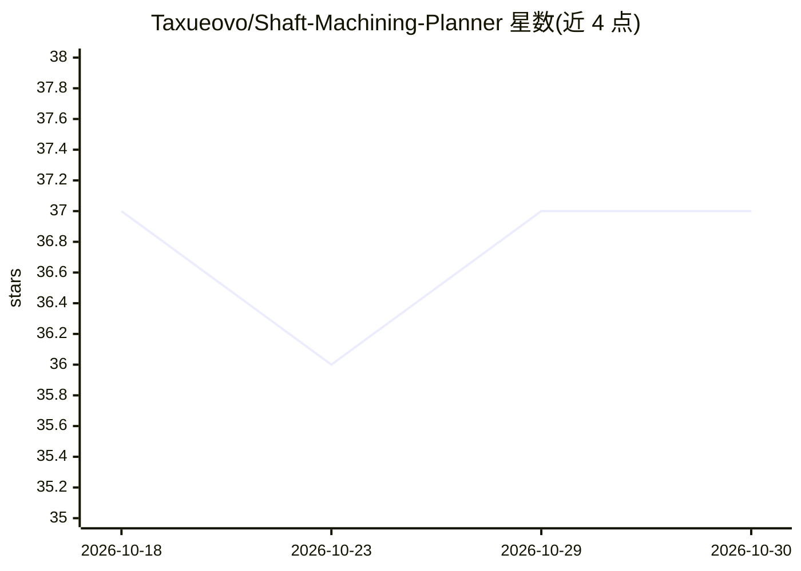

# Taxueovo/Shaft-Machining-Planner

⭐ 37 · Python · MIT · 推送 2026-10-08 · [GitHub](https://github.com/Taxueovo/Shaft-Machining-Planner) · 个人维护

**电机轴加工工艺规划工具：输入几何生成工艺路线并导出工艺卡**

面向制造工程师的轴类加工工艺规划应用：以结构化表单录入材料、阶梯轴段与键槽/花键/齿轮/内孔等特征，经规则与 LangGraph 工作流（含人工介入决策）生成含工序、机床、刀具、热处理的工艺路线，RAG（工艺手册+案例库）为规划提供依据，再对照本地机床/刀具能力库做规则校验，最终导出 Excel 工艺卡。前后端分离（FastAPI + Jinja2），支持 rules 纯离线模式，LLM 可接 OpenAI 兼容端点或 Ollama 本地模型。声明的边界：结果多为 conditional_pass，最终参数需工程师确认；不支持多用户与公网暴露。

## 筛选速览

| 维度 | 判定 | 备注 |
|---|---|---|
| AI 角色 | `ai-native` | 本体是模型或模型工具 |
| 许可风险 | `permissive` | MIT |
| 部署形态 | `library` | 以包/库形式分发 |
| 模型依赖 | local-ok | 支持本地模型 |
| 硬件要求 | — | 无带数字的原话,不猜 |
| 安装摩擦 | `low` | 无编译、无系统依赖或容器化 |
| 成熟度 | — | 结构信号不足 |

## 能力要点

- 结构化几何输入（键槽/花键/齿轮/阶梯内孔等）+ 交互式 3D 预览
- LangGraph 工作流含 interrupt/Command(resume) 人工介入工序时序决策
- RAG（工艺手册+案例库）注入规划流程，可选安装
- 机床/刀具能力库（Excel）规则校验，导出 Excel 工艺卡
- Planner-worker 任务 DAG：七个注册角色，确定性调度与重启续跑（SQLite 检查点）

## 适用场景

- 录入电机轴几何特征后生成可导出的加工工艺路线卡
- 对照自有机床与刀具能力库筛选可行工序
- 离线（rules 模式）或本地模型（Ollama）环境下做工艺规划

## 场景标签

 · 领域:制造业/工艺规划

## 证据(README 行号)

> L21: more — and generate a complete process route covering operations, machine tools,
> L22: cutting tools, heat treatment and finishing. Planning is grounded in RAG handbooks
> L23: and a case base, then checked against local capability libraries before Excel export.

## 星数曲线

2026-10-18 37 → 2026-10-30 37（+0）

---
*卡片 v1 · prompt 1.4 · 生成 2026-10-25 · 置信度 high · 依据 README sha `3704d07bbfe0` · [字段定义](../../DATASET.md)*
