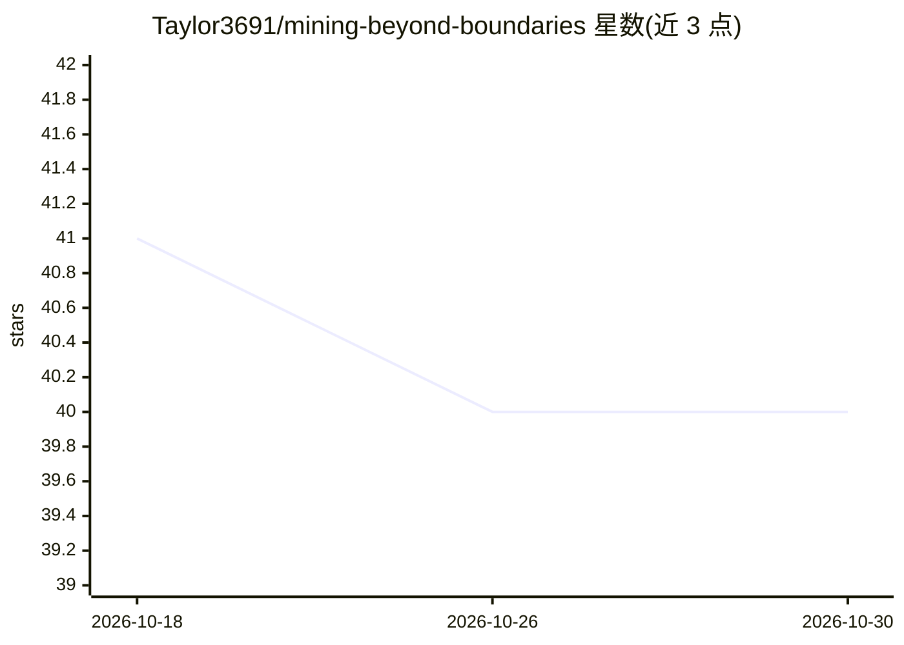

# Taylor3691/mining-beyond-boundaries

⭐ 40 · Jupyter Notebook · 推送 2026-04-23 · [GitHub](https://github.com/Taylor3691/mining-beyond-boundaries) · 组织维护

**课程数据挖掘项目：图像/表格/时间序列数据的预处理工具集**

Data Mining 2026 课程小组项目（5 名学生），用 Python 实现三类数据的端到端预处理：图像（pHash 去重、resize、增广、PCA/t-SNE 降维、SSIM/PSNR 评估）、表格（缺失值、IQR/Z-score 离群点、四种编码、SMOTE/ADASYN 不平衡处理）、时间序列（ADF/KPSS 平稳性检验、STL 分解、Granger 因果检验、随机森林预测）。基于 3 个 Kaggle 公开数据集，以 Jupyter Notebook 顺序执行为主，也提供可直接运行的 src 模块；需 Python 3.10+ 并手动下载数据。

## 筛选速览

| 维度 | 判定 | 备注 |
|---|---|---|
| AI 角色 | `ai-ecosystem` | LLM/agent 周边工具 |
| 许可风险 | `none` | — |
| 部署形态 | `library` | 以包/库形式分发 |
| 模型依赖 | — | README 未给出锁定关系 |
| 硬件要求 | — | 无带数字的原话,不猜 |
| 安装摩擦 | `low` | 无编译、无系统依赖或容器化 |
| 成熟度 | — | 结构信号不足 |

## 能力要点

- 图像/表格/时间序列三类数据共 20+ 个预处理与分析 Notebook
- 含 pHash 去重、KS 检验、MCAR 检验、Granger 因果检验等统计方法
- 提供 ImageDataset/TableDataset/TimeSeriesDataset 数据类与 src 模块直跑方式
- 通过 Kaggle CLI 拉取 3 个公开数据集并规定目录结构

## 适用场景

- 学习三类数据的标准预处理流程与配套 Notebook
- 对 Kaggle 公开数据集做 EDA 与清洗实验
- 作为课程实验中预处理步骤的参考实现

## 场景标签

`教程课程` · 领域:学习与行业

## 证据(README 行号)

> L3: Đồ án tiền xử lý dữ liệu cho môn **Data Mining 2026**, thực hiện khảo sát và cài đặt các kỹ thuật tiền xử lý trên 3 
> L85: |Tác vụ|Nội dung chi tiết|
> L105: |**Dự báo & kiểm định nhân quả**|Dự báo bằng Random Forest Regressor, kiểm định nhân quả Granger (Granger causalit

## 星数曲线

2026-10-18 41 → 2026-10-30 40（-1）

---
*卡片 v1 · prompt 1.4 · 生成 2026-10-25 · 置信度 mid · 依据 README sha `f54863750d40` · [字段定义](../../DATASET.md)*
