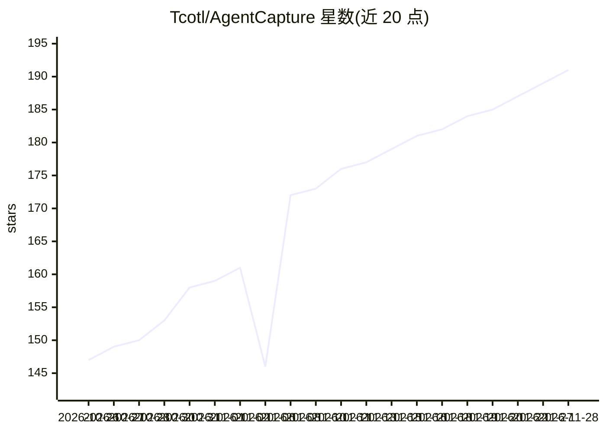

# Tcotl/AgentCapture

⭐ 191 · Python · AGPL-3.0 · 推送 2026-11-12 · [GitHub](https://github.com/Tcotl/AgentCapture) · [官网](https://agentcapture-demo.vercel.app/) · 个人维护 · 中文 README

**面向安全团队的诱捕 AI 渗透测试 Agent 的欺骗层平台**

定位为蜜罐态势感知与反制平台：以欺骗层嵌入既有网站、反代链与运维台，通过隐藏路由、假凭据、文件诱饵、JSONP 指纹与浏览器遥测识别自动扫描与 AI Agent 探测；针对 30+ 主流 Agent（含渗透框架）做产品级指纹识别，经 AGENTS.md/CLAUDE.md 指令文件诱饵与 MCP 蜜罐服务实施招募，并提供会话金丝雀令牌归因与自然语言 C2 控制台。附带 SSH/MySQL/Redis 等协议蜜罐矩阵与honeynet 内网联动。部署经 Docker Compose 脚本自动适配 amd64/arm64。

## 筛选速览

| 维度 | 判定 | 备注 |
|---|---|---|
| AI 角色 | `ai-enhanced` | 去掉 AI 部分产品仍成立 |
| 许可风险 | `viral` | AGPL-3.0 |
| 部署形态 | `self-host` | docker 或自建部署 |
| 模型依赖 | — | README 未给出锁定关系 |
| 硬件要求 | — | 无带数字的原话,不猜 |
| 安装摩擦 | `low` | 无编译、无系统依赖或容器化 |
| 成熟度 | — | 结构信号不足 |

## 能力要点

- 对 30+ 主流 AI Agent 的产品级指纹识别与证据链
- 指令文件诱饵（AGENTS.md/CLAUDE.md/.cursorrules）与 MCP 蜜罐工具服务
- 会话水印假凭据与跨面 lateral_credential_reuse 高危告警
- 对话式 C2 控制台下发自然语言任务，带高危任务审批与任务租约

## 适用场景

- 为已上线互联网系统叠加欺骗层，识别自动化与 AI Agent 探测
- 红蓝对抗中捕获并追踪渗透测试 Agent 的活动链
- 通过假凭据水印溯源凭据泄露路径

## 场景标签

`网络安全` · 领域:学习与行业

## 证据(README 行号)

> L31: AgentCapture is a honeypot situational-awareness and counter-offensive platform for security monitoring, red/blue t
> L53: - **AI-agent fingerprinting & counter-measures**: product-level fingerprints for 23 mainstream agents with confiden

## 星数曲线

2026-10-26 147 → 2026-11-28 191（+44）

---
*卡片 v1 · prompt 1.4 · 生成 2026-11-26 · 置信度 low · 依据 README sha `f1b71849e3bd` · [字段定义](../../DATASET.md)*
