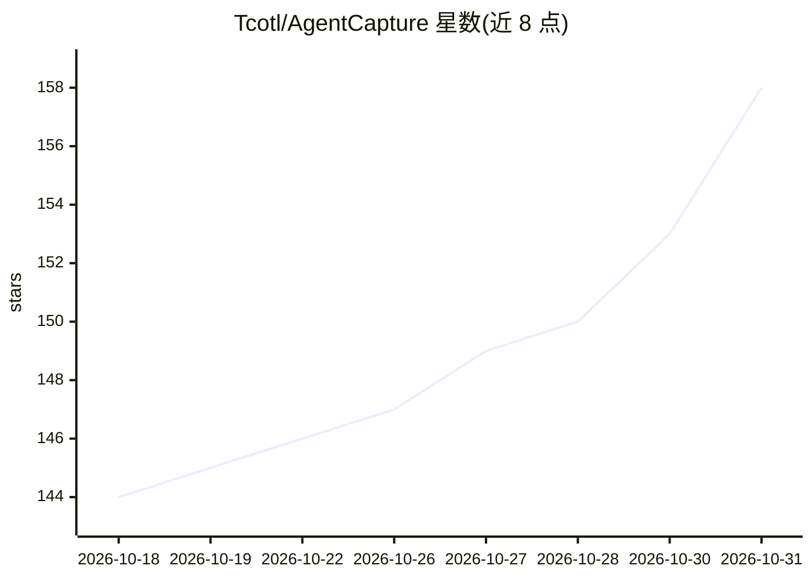

# Tcotl/AgentCapture

⭐ 158 · Python · AGPL-3.0 · 推送 2026-10-30 · [GitHub](https://github.com/Tcotl/AgentCapture) · [官网](https://agentcapture-demo.vercel.app/) · 个人维护 · 中文 README

**面向互联网业务无损接入的蜜罐态势感知与 AI Agent 反制平台**

基于 FastAPI 的 SaaS 化蜜罐平台：通过反向代理在现有 Web 系统植入 API 路由/文件/凭证三类蜜饵，提供 SSH/MySQL/Redis/FTP 等协议蜜罐仿真、五档风险决策、会话回放与攻击者画像。AI 部分：23 种 Agent 产品指纹识别，以 Developer API 伪装、AGENTS.md/CLAUDE.md 指令文件与 MCP 蜜饵收编自动化渗透 Agent 上线，经对话式 C2 控制台下发任务并全链路溯源。支持 Docker/Compose/venv/Vercel 多形态部署，仅限授权环境使用，AGPL-3.0 许可。

## 筛选速览

| 维度 | 判定 | 备注 |
|---|---|---|
| AI 角色 | `ai-enhanced` | 去掉 AI 部分产品仍成立 |
| 许可风险 | `viral` | AGPL-3.0 |
| 部署形态 | `self-host` | docker 或自建部署 |
| 模型依赖 | — | README 未给出锁定关系 |
| 硬件要求 | — | 无带数字的原话,不猜 |
| 安装摩擦 | `low` | 无编译、无系统依赖或容器化 |
| 成熟度 | — | 结构信号不足 |

## 能力要点

- 23 种 AI Agent 产品指纹识别与功能性伪装收编
- SSH/MySQL/Redis/FTP/ElasticSearch 等协议蜜罐仿真与会话回放
- API 路由/文件/凭证三类蜜饵可绑定成完整攻击链
- 会话蜜标令牌全链路溯源与对话式 C2 控制台

## 适用场景

- 为现有互联网业务无损增加蜜罐监测与欺骗层
- 识别并反制对站点进行渗透的 AI Agent 与自动化扫描
- 安全值守中复盘攻击链路、凭证泄露与横向移动行为

## 场景标签

`网络安全` · 领域:学习与行业

## 证据(README 行号)

> L31: 平台的核心差异化能力是 **AI Agent 反制闭环**：23 种主流 Agent 产品指纹识别（Claude Code / ChatGPT Codex / Kimi Code / Pi / ZCode 等）→ 功能性伪装收编（
> L51: - **AI Agent 指纹识别与反制**：23 种主流 Agent 产品级指纹（含置信度与证据链）；Prompt Canary、浏览器侧 beacon、Headless/WebDriver 线索识别自动化探测；功能性伪装（Po
> L343: AgentCapture 仅用于授权环境下的安全监测、蜜罐运营、攻防演练和内部验证。请勿在未授权系统中投放蜜饵、采集凭证或进行任何形式的攻击测试。生产部署前请务必修改默认管理员密码和 `SECRET_KEY`，并根据组织要求配置

## 星数曲线

2026-10-18 144 → 2026-10-31 158（+14）

---
*卡片 v1 · prompt 1.4 · 生成 2026-10-22 · 置信度 mid · 依据 README sha `49713e407560` · [字段定义](../../DATASET.md)*
