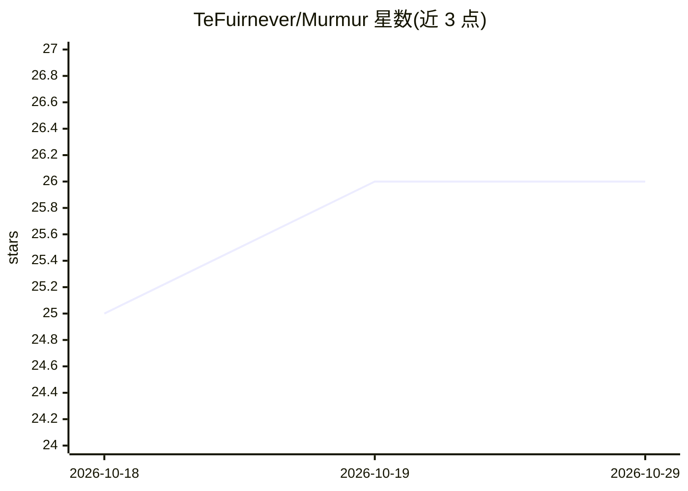

# TeFuirnever/Murmur

⭐ 26 · TypeScript · NOASSERTION · 推送 2026-10-24 · [GitHub](https://github.com/TeFuirnever/Murmur) · [官网](https://tefuirnever.github.io/Murmur/) · 个人维护 · 中文 README

**本地优先的中文 AI 语音输入与转录桌面工具**

基于 Electron 的 macOS/Windows 桌面应用，核心是用 FunASR（Paraformer-large + FSMN-VAD + CT-Transformer）在本地做中文语音识别：全局热键按下即说话转文字到光标处，支持 wav/mp3/m4a/flac 文件批量转录，历史记录存 SQLite 可搜索导出。识别后可选接入 11+ 个 OpenAI 兼容模型（含本地 Ollama/LM Studio）做文本润色、去口癖、生成纪要。全程不上传数据；首次运行需下载约 671MB 模型；单文件超 10 分钟会超时，实时流式转写尚在路线图中。

## 筛选速览

| 维度 | 判定 | 备注 |
|---|---|---|
| AI 角色 | `ai-native` | 本体是模型或模型工具 |
| 许可风险 | `permissive` | NOASSERTION |
| 部署形态 | `desktop` | 安装包/桌面程序 |
| 模型依赖 | local-ok | 支持本地模型 |
| 硬件要求 | — | 无带数字的原话,不猜 |
| 安装摩擦 | `medium` | 含编译或系统依赖之一 |
| 成熟度 | — | 结构信号不足 |

## 能力要点

- FunASR 本地中文语音识别（Paraformer-large + VAD + 标点）
- 全局热键语音输入，文字直接出现在光标处
- 音频文件批量转录与 TXT/SRT/Markdown/DOCX 导出
- 11+ 个 OpenAI 兼容 AI 后端（含本地 Ollama/LM Studio）做润色与纪要

## 适用场景

- 打字慢或不便时用热键语音输入中文
- 批量转录会议录音并让 AI 整理成纪要
- 数据不出本机的前提下完成语音转文字

## 场景标签

`语音识别` `AI 写作` · 领域:内容生成

## 证据(README 行号)

> L27: **Murmur is a local-first speech-to-text tool optimized for Chinese.** It's more than "voice input" — press a hotke
> L152: |Speech|FunASR (Paraformer-large + FSMN-VAD + CT-Transformer)|

## 星数曲线

2026-10-18 25 → 2026-10-29 26（+1）

---
*卡片 v1 · prompt 1.4 · 生成 2026-10-26 · 置信度 mid · 依据 README sha `ba51fa5cdb2b` · [字段定义](../../DATASET.md)*
