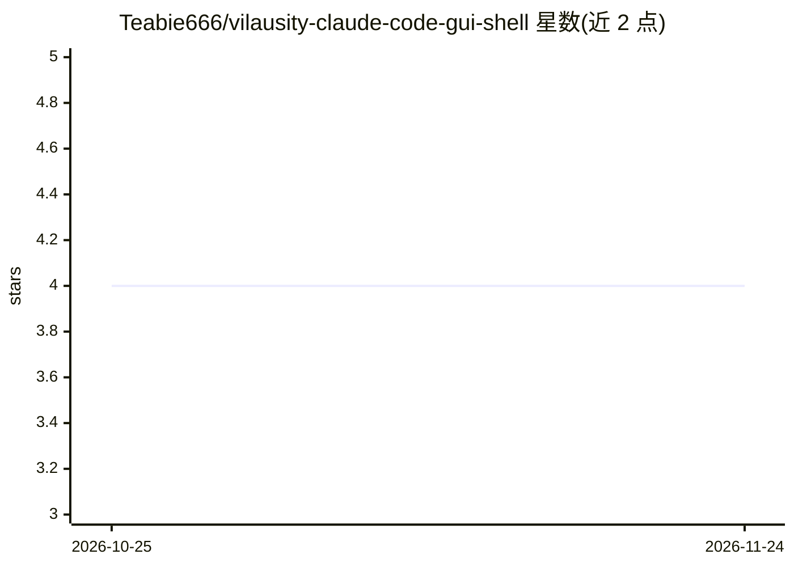

# Teabie666/vilausity-claude-code-gui-shell

⭐ 4 · TypeScript · GPL-3.0 · 推送 2026-11-17 · [GitHub](https://github.com/Teabie666/vilausity-claude-code-gui-shell) · 个人维护 · 中文 README

**Windows 桌面 Claude Code 客户端，填 API key 即用**

基于 Electron 的 Windows 桌面应用，核心运行 Anthropic 发布的 Claude Code VS Code 插件（不打包、不修改），外层提供 VS Code 风格界面：会话列表、Monaco 编辑器、diff 审阅、多标签对话、评论、全局搜索、任务栏状态提示等。为国内模型 API 接入做适配，内置 DeepSeek、Kimi、GLM、千问、火山方舟等预设，每个窗口可绑定不同接口并以颜色区分。密钥用 Windows DPAPI 加密保存。仅支持 Windows 10/11（x64），目前处于测试阶段，为个人开发的第三方项目。

## 筛选速览

| 维度 | 判定 | 备注 |
|---|---|---|
| AI 角色 | `ai-ecosystem` | LLM/agent 周边工具 |
| 许可风险 | `viral` | GPL-3.0 |
| 部署形态 | `None` |  |
| 模型依赖 | locked-api |  |
| 硬件要求 | — | 无带数字的原话,不猜 |
| 安装摩擦 | `low` | 无编译、无系统依赖或容器化 |
| 成熟度 | `idea` | |

## 能力要点

- 核心为官方 Claude Code 插件，自动从 Open VSX 下载并支持版本回退/锁定
- 内置 DeepSeek、Kimi、GLM、千问等 API 预设，多窗口多接口并按颜色区分
- 内置 VS Code 同款 Monaco 编辑器内核，diff 审阅与评论功能
- 花费统计按对话/工作区/历史汇总，价格按时段分档

## 适用场景

- 不想装 VS Code 或开命令行，直接用图形界面跑 Claude Code
- 用 DeepSeek 等国内 API key 驱动 Claude Code 的 agent 能力
- 让 AI 在指定文件夹里改文件、跑命令来修软件、整理文件、写小工具

## 场景标签

`编码 Agent` · 领域:编码与开发

## 证据(README 行号)

> L11: > 本仓库为个人开发的第三方项目，与 Anthropic、Microsoft 没有关联。Claude Code 插件是 Anthropic 的软件，Vilausity 不打包、不修改。
> L24: - **官方内核**：核心就是官方 Claude Code 插件，它有的功能这里都有。插件自动更新，更新出了问题一键退回上个版本。

## 星数曲线

2026-10-25 4 → 2026-11-24 4（+0）

---
*卡片 v1 · prompt 1.4 · 生成 2026-11-21 · 置信度 high · 依据 README sha `16306ed27024` · [字段定义](../../DATASET.md)*
