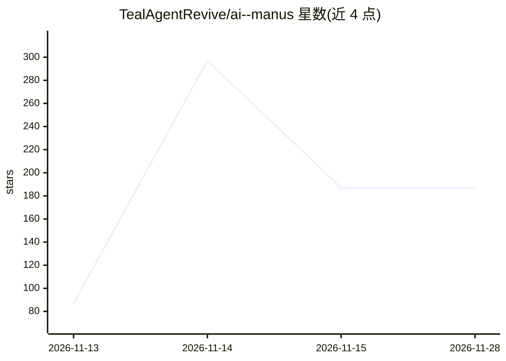

# TealAgentRevive/ai--manus

⭐ 187 · Apache-2.0 · 推送 2026-11-15 · [GitHub](https://github.com/TealAgentRevive/ai--manus) · 个人维护

**面向日常小任务的自主 AI Agent，可执行代码并控制浏览器**

README 描述的 Manus 自主 AI 代理：可自行编写并执行脚本、控制浏览器（打开网页、填表、收集信息）、执行多步骤任务，定位为家庭、学习与轻量办公场景的后台个人助手，无需用户具备开发背景。给出最低 4 GB 内存/双核 CPU 的兼容性表格，但全文未提供任何安装命令、运行方式或模型接入细节，主要功能陈述以宣传式要点呈现，可验证的技术机制有限。

## 筛选速览

| 维度 | 判定 | 备注 |
|---|---|---|
| AI 角色 | `ai-native` | 本体是模型或模型工具 |
| 许可风险 | `permissive` | Apache-2.0 |
| 部署形态 | `None` |  |
| 模型依赖 | — | README 未给出锁定关系 |
| 硬件要求 | — | 无带数字的原话,不猜 |
| 安装摩擦 | `low` | 无编译、无系统依赖或容器化 |
| 成熟度 | — | 结构信号不足 |

## 能力要点

- 自主代码执行：代理自行编写并运行脚本完成任务
- 浏览器控制：导航网页、填写表单、收集信息
- 代码与浏览器动作可在同一任务流程中衔接

## 适用场景

- 让代理代为整理研究资料、跑小脚本
- 自动检查网页更新信息或填写重复表单
- 把日常重复性小任务委托给后台代理处理

## 场景标签

`AI 助手` `浏览器自动化` · 领域:效率与自动化

## 证据(README 行号)

> L10: - **Autonomous Code Execution:** Manus AI agent runs code on its own to complete tasks, so you can focus on decisio
> L18: Manus is an autonomous AI agent designed to run code and control a browser on your behalf. Instead of acting like a
> L22: Manus is not a heavy studio suite or a complex enterprise platform. It is a focused helper built for home, study, a

## 星数曲线

2026-11-13 87 → 2026-11-28 187（+100）

---
*卡片 v1 · prompt 1.4 · 生成 2026-11-17 · 置信度 low · 依据 README sha `a3d88e202bf0` · [字段定义](../../DATASET.md)*
