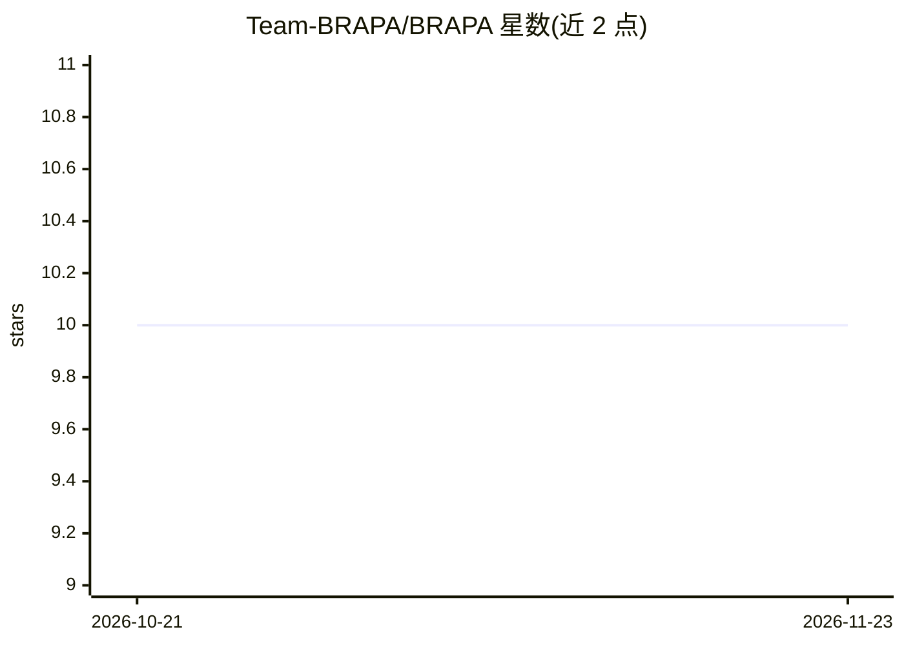

# Team-BRAPA/BRAPA

⭐ 10 · 推送 2026-07-06 · [GitHub](https://github.com/Team-BRAPA/BRAPA) · 个人维护

**面向语音合成器的巴西葡萄牙语音标字母表资源**

BRAPA（Brazilian Phonetic Alphabet）是一个为合成器（synthesizers）制作的巴西葡萄牙语音标字母表，以 Arpabet 为基础，旨在简化合成器使用，提供更直观快速的书写方式，避免特殊字符影响 AI 训练及歌声/语音合成器的使用。其音素索引设计为灵活可调整，可按巴西各地区口音由用户自行适配。仓库提供 X-Sampa 到 BRAPA 的转换表，格式为 .ods 与 .xlsx 电子表格，并支持在线查看列表。

## 筛选速览

| 维度 | 判定 | 备注 |
|---|---|---|
| AI 角色 | `ai-knowledge` | 知识聚合/清单类 |
| 许可风险 | `none` | — |
| 部署形态 | `None` |  |
| 模型依赖 | — | README 未给出锁定关系 |
| 硬件要求 | — | 无带数字的原话,不猜 |
| 安装摩擦 | `low` | 无编译、无系统依赖或容器化 |
| 成熟度 | — | 结构信号不足 |

## 能力要点

- 基于 Arpabet 的巴西葡萄牙语音标体系
- 提供 X-Sampa→BRAPA 转换表（.ods/.xlsx）
- 音素索引可按地区口音灵活适配
- 支持在线浏览音素列表

## 适用场景

- 为巴西葡萄牙语歌声/语音合成准备音标输入
- 训练语音合成模型时避免特殊字符干扰
- 按巴西地区口音定制音素映射

## 场景标签

`语音合成` · 领域:内容生成

## 证据(README 行号)

> L5: BRAPA (Brazilian Phonetic Alphabet) é um alfabeto fonético feito para sintetizadores focado nos fonemas mais comuns 
> L7: Utilizando Arpabet como base, seu objetivo é simplificar o uso dos sintetizadores trazendo uma linguagem mais intuit
> L11: No download, assim como nesse repositório, contém planilhas de conversão X-Sampa -> BRAPA nos formatos `.ods` e `.x

## 星数曲线

2026-10-21 10 → 2026-11-23 10（+0）

---
*卡片 v1 · prompt 1.4 · 生成 2026-11-20 · 置信度 high · 依据 README sha `57cbba386ad5` · [字段定义](../../DATASET.md)*
