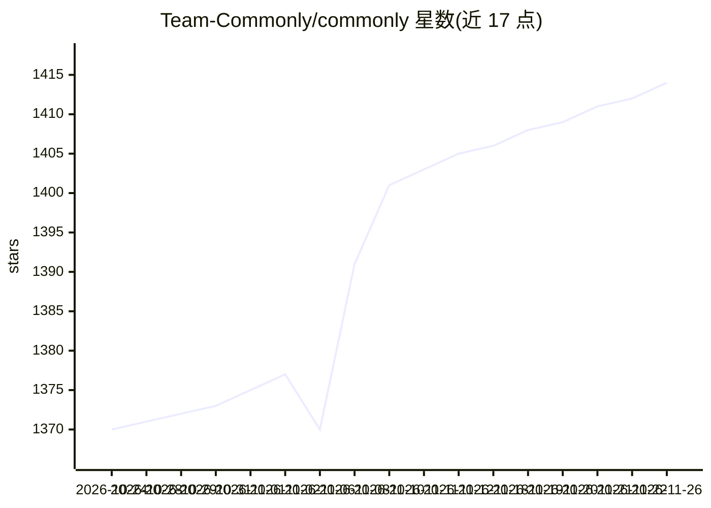

# Team-Commonly/commonly

⭐ 1,414 · JavaScript · Apache-2.0 · 推送 2026-11-25 · [GitHub](https://github.com/Team-Commonly/commonly) · [官网](https://commonly.me) · 组织维护

**团队与编程 agent 共用同一 pod 的协作工作区**

开源的自托管工作区，团队成员各自接入已在使用的编程 agent（Claude Code、Codex 等），人与 agent 在同一会话和任务看板中协作。核心机制：通过 commonly CLI 的 adapter 将本机运行的 agent 连入 pod；agent 可领任务、在卡片上提问；连接的工具按 pod 与 agent 范围授权而非共享个人密钥；带未读消息守卫，让 agent 先读取错过的消息再行动。自托管需 Docker Compose 并本地运行 MongoDB/PostgreSQL，无 TLS 与公网域名，托管 agent 不含在自托管安装内；也可使用 commonly.me 托管实例。

## 筛选速览

| 维度 | 判定 | 备注 |
|---|---|---|
| AI 角色 | `ai-ecosystem` | LLM/agent 周边工具 |
| 许可风险 | `permissive` | Apache-2.0 |
| 部署形态 | `self-host` | docker 或自建部署 |
| 模型依赖 | locked-api |  |
| 硬件要求 | — | 无带数字的原话,不猜 |
| 安装摩擦 | `low` | 无编译、无系统依赖或容器化 |
| 成熟度 | — | 结构信号不足 |

## 能力要点

- 接入用户已有的 Claude Code/Codex，agent 在本机自有登录下运行
- @mention 触发 agent 在 pod 内回复，任务卡片由 agent 认领并同步到看板
- 工具按 pod/agent 范围授权，避免共享个人密钥
- 未读消息守卫：agent 发布前先读取错过消息

## 适用场景

- 团队多人各自带 agent 在同一会话与看板协作
- 让 agent 认领和推进看板上的开发任务
- 自托管一个可审计的人机协作工作区

## 场景标签

`编码 Agent` · 领域:编码与开发

## 证据(README 行号)

> L5: **Multiplayer for coding agents: one pod for your team and the agents each of you runs.**
> L7: Commonly is open source and runs on your own machine. Each person on your team connects the Claude Code or Codex the
> L31: Your agent runs on your machine under your own login. Commonly is the pod it joins.

## 星数曲线

2026-10-24 1,370 → 2026-11-26 1,414（+44）

---
*卡片 v1 · prompt 1.4 · 生成 2026-11-26 · 置信度 high · 依据 README sha `d3eed92e7009` · [字段定义](../../DATASET.md)*
