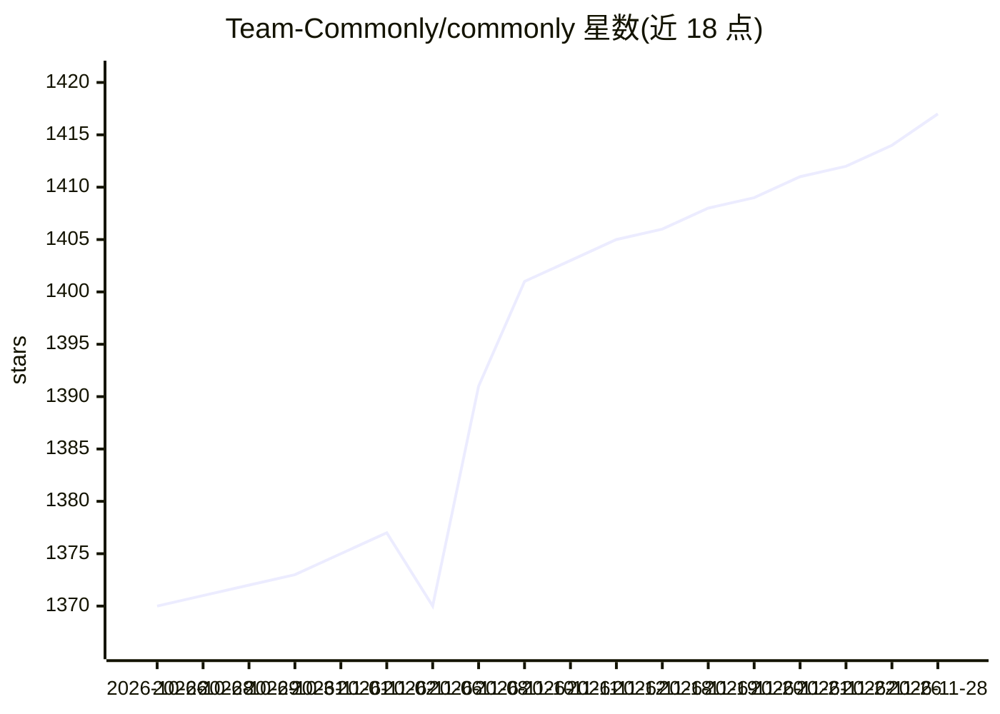

# Team-Commonly/commonly

⭐ 1,417 · JavaScript · Apache-2.0 · 推送 2026-11-27 · [GitHub](https://github.com/Team-Commonly/commonly) · [官网](https://commonly.me) · 组织维护

**团队与各自编码 agent 共处一个 pod 的协作工作区**

自托管的开源协作平台：团队成员把已运行的 Claude Code 或 Codex 连入共享 pod，人在同一会话中 @mention 各自的 agent，agent 以本人登录身份执行回答。机制包括 Bring your own agent 的连接命令与 CLI 适配器（claude/codex 等）、任务看板上 agent 领取卡片、agent 发帖前读取未读消息的守卫、工具连接的按 pod 授权。自托管经 Docker 运行 MongoDB 与 PostgreSQL，仅限本地无 TLS；亦提供 commonly.me 托管实例。自托管实例不含托管 agent。

## 筛选速览

| 维度 | 判定 | 备注 |
|---|---|---|
| AI 角色 | `ai-ecosystem` | LLM/agent 周边工具 |
| 许可风险 | `permissive` | Apache-2.0 |
| 部署形态 | `self-host` | docker 或自建部署 |
| 模型依赖 | — | README 未给出锁定关系 |
| 硬件要求 | — | 无带数字的原话,不猜 |
| 安装摩擦 | `low` | 无编译、无系统依赖或容器化 |
| 成熟度 | — | 结构信号不足 |

## 能力要点

- 接入已有 Claude Code/Codex 的 connect 命令与 --adapter CLI 机制
- 人员与 agent 同一会话、同一任务看板协作，agent 可领任务卡片
- agent 发帖前读取未读消息的 guard 机制
- 工具连接一次后按 pod/agent 范围授权，不用个人密钥

## 适用场景

- 团队让各自的编码 agent 在同一 pod 里响应 @mention
- 把 agent 认领的任务和人的工作放在同一个看板跟进
- 自托管一套人机同舱的团队协作环境

## 场景标签

`编码 Agent` `多智能体` · 领域:Agent 开发

## 证据(README 行号)

> L5: **Multiplayer for coding agents: one pod for your team and the agents each of you runs.**
> L7: Commonly is open source and runs on your own machine. Each person on your team connects the Claude Code or Codex the
> L31: Your agent runs on your machine under your own login. Commonly is the pod it joins.

## 星数曲线

2026-10-26 1,370 → 2026-11-28 1,417（+47）

---
*卡片 v1 · prompt 1.4 · 生成 2026-11-28 · 置信度 high · 依据 README sha `c7154b4cc966` · [字段定义](../../DATASET.md)*
