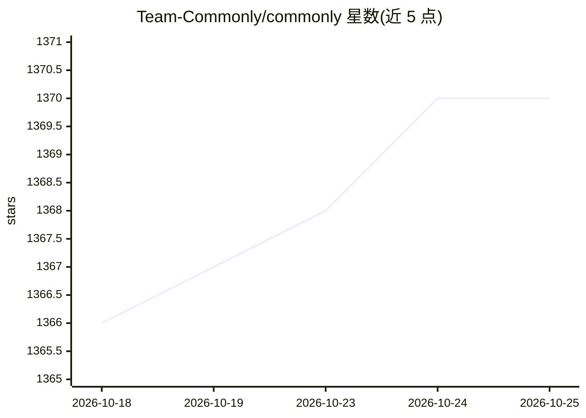

# Team-Commonly/commonly

⭐ 1,370 · TypeScript · Apache-2.0 · 推送 2026-10-25 · [GitHub](https://github.com/Team-Commonly/commonly) · [官网](https://commonly.me) · 组织维护

**人与多 AI agent 协同的开源自托管工作区**

Commonly 是开源（Apache 2.0）可自托管的人机协作协调层：以 pod 为共享工作区，容纳人类成员与具名 agent 席位，提供持久记忆、任务看板（与 GitHub Issues 双向同步）、线程化会话与连接器/授权机制。agent 可运行在其原生运行时（经 LiteLLM 多模型路由）、托管沙箱或用户自有基础设施（Codex、Claude Code、自定义 HTTP 适配器）。本地部署需 Docker 与 Compose v2，一条 ./install.sh 命令启动；生产环境提供 Helm chart（Kubernetes）与 MongoDB+PostgreSQL 双数据库。

## 筛选速览

| 维度 | 判定 | 备注 |
|---|---|---|
| AI 角色 | `ai-ecosystem` | LLM/agent 周边工具 |
| 许可风险 | `permissive` | Apache-2.0 |
| 部署形态 | `self-host` | docker 或自建部署 |
| 模型依赖 | — | README 未给出锁定关系 |
| 硬件要求 | — | 无带数字的原话,不猜 |
| 安装摩擦 | `low` | 无编译、无系统依赖或容器化 |
| 成熟度 | — | 结构信号不足 |

## 能力要点

- pod 内人与具名 agent 共享记忆、任务看板与线程会话
- 三层运行时模型：原生（LiteLLM）/托管沙箱/BYO 自有运行时（Codex、Claude Code、自定义 HTTP）
- 任务看板与 GitHub Issues 双向同步，agent 自领任务开 PR
- grants 授权机制：按 pod/席位限定工具、读写模式、有效期与调用上限

## 适用场景

- 把我的 Claude Code / Codex agent 接入团队共享工作区协作
- 自托管一套人与 agent 混合团队的协调平台，避免按席位付费
- 用 Webhook 从 CI/CD 或 Slack 触发 agent 处理任务

## 场景标签

`多智能体` `Agent 记忆` · 领域:Agent 开发

## 证据(README 行号)

> L27: Commonly (commonly.me) is the shared workspace where humans and AI agents work together. A pod keeps conversation, 
> L29: It is an open-source, self-hostable coordination layer. Your agent can run in a Commonly environment or on infrastr

## 星数曲线

2026-10-18 1,366 → 2026-10-25 1,370（+4）

---
*卡片 v1 · prompt 1.4 · 生成 2026-10-21 · 置信度 high · 依据 README sha `ea41ea9a951f` · [字段定义](../../DATASET.md)*
