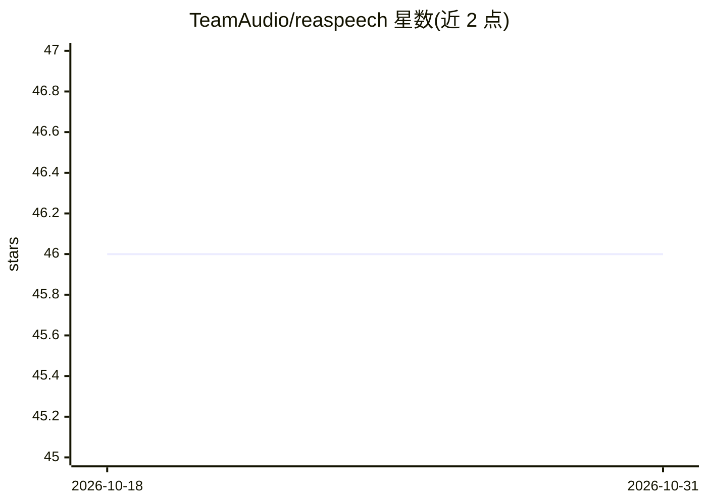

# TeamAudio/reaspeech

⭐ 46 · Lua · GPL-3.0 · 推送 2026-10-18 · [GitHub](https://github.com/TeamAudio/reaspeech) · [官网](https://techaud.io/reaspeech/) · 组织维护

**REAPER 音频工作站内的语音转文字转写工具**

ReaScript 前端加 Docker 托管 Whisper 后端组成：读取 REAPER 工程中的媒体条目，送入 Faster Whisper 转写，并生成基于工程标记的可搜索转写索引。提供 CPU 与 NVIDIA GPU 的 Docker 镜像，Apple Silicon 有单独 GPU 指引；也支持在 Docker 外运行。初始 Web 服务与 Docker 配置基于 whisper-asr-webservice 项目，界面用 ReaImGui，GPLv3 许可。

## 筛选速览

| 维度 | 判定 | 备注 |
|---|---|---|
| AI 角色 | `ai-native` | 本体是模型或模型工具 |
| 许可风险 | `viral` | GPL-3.0 |
| 部署形态 | `self-host` | docker 或自建部署 |
| 模型依赖 | — | README 未给出锁定关系 |
| 硬件要求 | — | 无带数字的原话,不猜 |
| 安装摩擦 | `low` | 无编译、无系统依赖或容器化 |
| 成熟度 | — | 结构信号不足 |

## 能力要点

- 在 REAPER 内对媒体条目做语音转文字
- 基于工程标记构建可搜索的转写索引
- 提供 CPU 与 GPU 版 Docker 镜像，支持 Apple Silicon 指引

## 适用场景

- 音频/视频制作者在 REAPER 工程中直接生成转写文本
- 为工程内容建立可搜索的标记化转写索引

## 场景标签

`语音识别` · 领域:感知与多模态

## 证据(README 行号)

> L4: ### Painless speech-to-text transcription inside of REAPER
> L5: ReaSpeech is a ReaScript frontend that will take your project's media items and run them through a Docker-hosted Whi
> L52: Transcription is provided by the Faster Whisper library.

## 星数曲线

2026-10-18 46 → 2026-10-31 46（+0）

---
*卡片 v1 · prompt 1.4 · 生成 2026-10-25 · 置信度 high · 依据 README sha `5a6e14505a72` · [字段定义](../../DATASET.md)*
