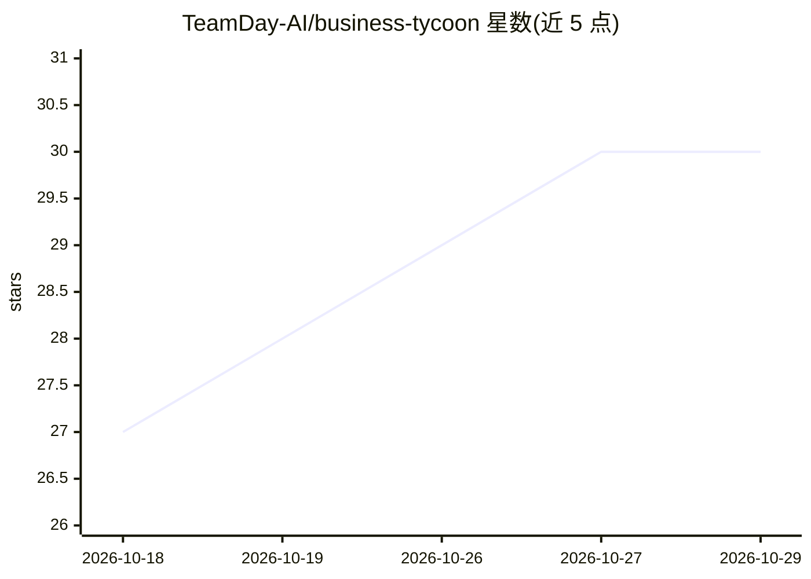

# TeamDay-AI/business-tycoon

⭐ 30 · JavaScript · MIT · 推送 2026-03-05 · [GitHub](https://github.com/TeamDay-AI/business-tycoon) · [官网](https://tycoon.teamday.ai) · 组织维护

**浏览器直接运行的等距 AI 创业公司模拟经营游戏**

开源、纯 Vanilla JavaScript 编写的浏览器经营模拟游戏：玩家经营一家 AI 初创公司，在等距视角下建造办公室、雇佣具有性格与心情设定的 AI 员工、承接项目、研究科技树、管理 MRR 与现金流并应对随机事件。全部逻辑在客户端运行，无服务器、无数据库、无账号，支持 PWA 离线安装。无构建步骤、零依赖，克隆仓库后用任意静态 HTTP 服务器即可本地运行。含一个可选的 AI CEO 顾问功能，使用外部 API。

## 筛选速览

| 维度 | 判定 | 备注 |
|---|---|---|
| AI 角色 | `ai-enhanced` | 去掉 AI 部分产品仍成立 |
| 许可风险 | `permissive` | MIT |
| 部署形态 | `None` |  |
| 模型依赖 | — | README 未给出锁定关系 |
| 硬件要求 | — | 无带数字的原话,不猜 |
| 安装摩擦 | `low` | 无编译、无系统依赖或容器化 |
| 成熟度 | — | 结构信号不足 |

## 能力要点

- 等距办公室建造（房间、走廊、家具）与员工性格/心情系统
- 科技树研究、项目交付与 MRR/贷款等经济系统
- 纯客户端运行，零依赖、无构建步骤，支持 PWA 离线
- 可选 AI CEO 顾问（外部 API 提供策略建议）

## 适用场景

- 在浏览器中即点即玩经营模拟游戏
- 离线安装在手机或桌面游玩
- 作为零依赖前端游戏项目学习或二次修改

## 场景标签

 · 领域:游戏/模拟经营

## 证据(README 行号)

> L21: Business Tycoon is a free, browser-based tycoon game where you run an AI startup. You start with a small office and
> L33: - **AI CEO advisor** — Get strategic advice from an AI-powered advisor (optional, uses external API).
> L5:  An open-source isometric AI office simulator you can play right in your browser.

## 星数曲线

2026-10-18 27 → 2026-10-29 30（+3）

---
*卡片 v1 · prompt 1.4 · 生成 2026-10-26 · 置信度 mid · 依据 README sha `865f18765d8c` · [字段定义](../../DATASET.md)*
