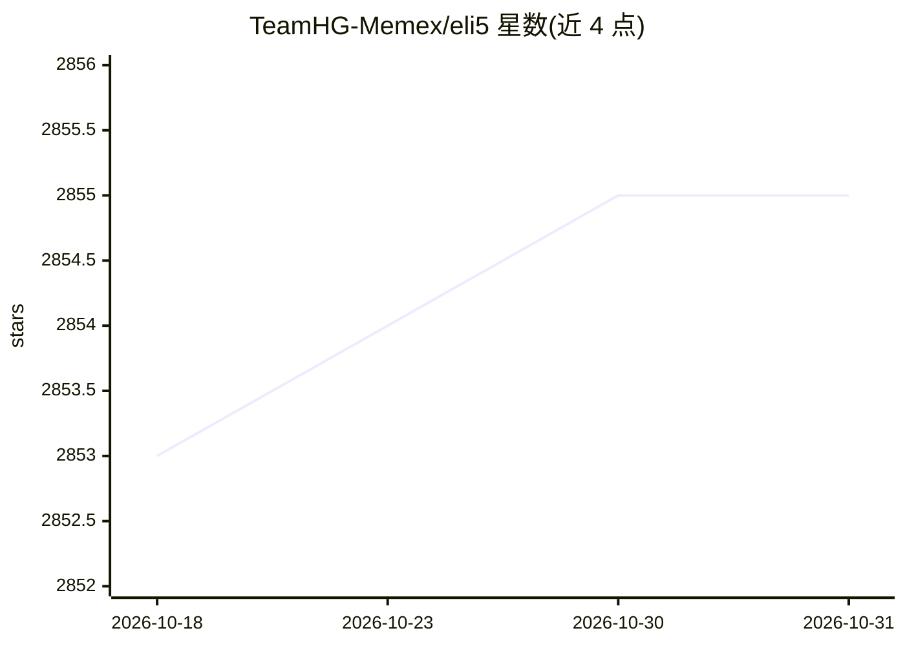

# TeamHG-Memex/eli5

⭐ 2,855 · Jupyter Notebook · MIT · 推送 2026-04-08 · [GitHub](https://github.com/TeamHG-Memex/eli5) · [官网](http://eli5.readthedocs.io) · 组织维护

**调试机器学习分类器并解释其预测的 Python 库**

Python 库，用于检查机器学习分类器并解释预测结果。支持 scikit-learn（线性模型权重、决策树文本/SVG 输出、特征重要性、Pipeline/FeatureUnion）、Keras（Grad-CAM 图像分类可视化）、XGBoost、LightGBM、CatBoost、lightning 与 sklearn-crfsuite。另实现黑盒模型检查算法：基于 LIME 的 TextExplainer 解释任意文本分类器、Permutation importance 计算黑盒特征重要性。解释与格式化分离，可输出文本、HTML、pandas.DataFrame 或 JSON。部分非文本 LIME 功能标注为实验性。

## 筛选速览

| 维度 | 判定 | 备注 |
|---|---|---|
| AI 角色 | `ai-ecosystem` | LLM/agent 周边工具 |
| 许可风险 | `permissive` | MIT |
| 部署形态 | `library` | 以包/库形式分发 |
| 模型依赖 | — | README 未给出锁定关系 |
| 硬件要求 | — | 无带数字的原话,不猜 |
| 安装摩擦 | `low` | 无编译、无系统依赖或容器化 |
| 成熟度 | `idea` | |

## 能力要点

- 解释多框架模型的权重与预测（scikit-learn/XGBoost/LightGBM/CatBoost/Keras 等）
- 基于 LIME 的 TextExplainer 与 Permutation importance 检查黑盒模型
- 输出格式支持文本/HTML/DataFrame/JSON
- 可视化能力：文本高亮、Grad-CAM 图像热图、决策树 SVG

## 适用场景

- 调试并理解自己训练的分类器为何做出某预测
- 为黑盒模型计算特征重要性
- 在 notebook 或 web 面板中嵌入预测解释展示

## 场景标签

`模型评测` · 领域:评测与运维

## 证据(README 行号)

> L19: ELI5 is a Python package which helps to debug machine learning
> L20: classifiers and explain their predictions.
> L56: ELI5 also implements several algorithms for inspecting black-box models

## 星数曲线

2026-10-18 2,853 → 2026-10-31 2,855（+2）

---
*卡片 v1 · prompt 1.4 · 生成 2026-10-21 · 置信度 high · 依据 README sha `094dcc0151cd` · [字段定义](../../DATASET.md)*
