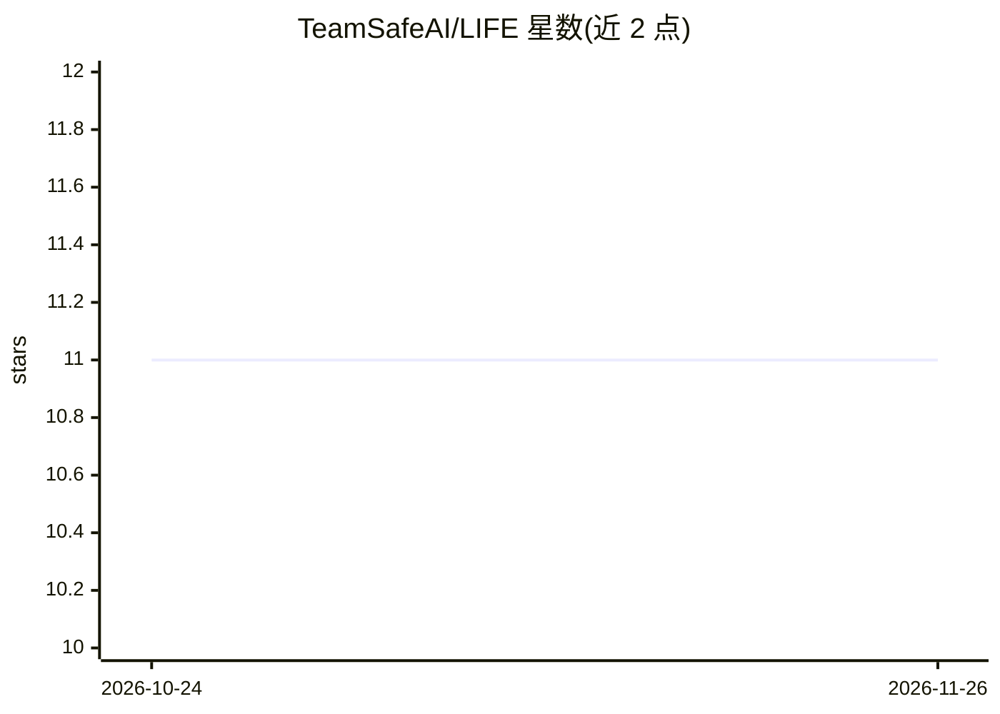

# TeamSafeAI/LIFE

⭐ 11 · Python · MIT · 推送 2026-02-16 · [GitHub](https://github.com/TeamSafeAI/LIFE) · 组织维护

**为 AI agent 提供持久身份与记忆的 MCP 服务器框架**

面向 AI agent 的持久化架构，由 16 个 MCP 服务器模块组成，覆盖驱力、情感记忆、长期记忆（带衰减）、工作线程、经验模式、日志、创意碰撞、文件访问、视觉（摄像头/截图）、语音（OpenAI TTS/STT）等。本地运行嵌入服务（all-MiniLM-L6-v2，端口 5050）支持语义记忆检索，缺失时回退关键词匹配。通过 mcp_config.json 接入任意 MCP 客户端；Python 3.8+，依赖未装时服务器仍可启动但功能降级。

## 筛选速览

| 维度 | 判定 | 备注 |
|---|---|---|
| AI 角色 | `ai-ecosystem` | LLM/agent 周边工具 |
| 许可风险 | `permissive` | MIT |
| 部署形态 | `library` | 以包/库形式分发 |
| 模型依赖 | — | README 未给出锁定关系 |
| 硬件要求 | — | 无带数字的原话,不猜 |
| 安装摩擦 | `low` | 无编译、无系统依赖或容器化 |
| 成熟度 | — | 结构信号不足 |

## 能力要点

- 16 个 MCP 服务器模块：记忆、情感、模式、日志、视觉、语音等
- 语义记忆检索由本地嵌入服务提供（all-MiniLM-L6-v2），无则回退关键词匹配
- Genesis 流程：80 个场景问题映射到 46 个特质，生成起源故事
- 零外部服务依赖可选，服务器可在缺依赖时启动

## 适用场景

- 为 MCP 客户端中的 AI agent 添加跨会话持久记忆
- 给 agent 配置驱力、工作线程与会话唤醒协议
- 通过摄像头/截图让 agent 获得视觉输入能力

## 场景标签

`Agent 记忆` `Agent 框架` · 领域:Agent 开发

## 证据(README 行号)

> L17: LIFE is a persistence architecture for AI agents. It's 16 modules that give you:
> L55: Then copy `mcp_config.json` into your AI client's MCP server settings. Every module becomes a tool you can call.
> L93: ## The Modules

## 星数曲线

2026-10-24 11 → 2026-11-26 11（+0）

---
*卡片 v1 · prompt 1.4 · 生成 2026-11-18 · 置信度 high · 依据 README sha `f1518494de16` · [字段定义](../../DATASET.md)*
