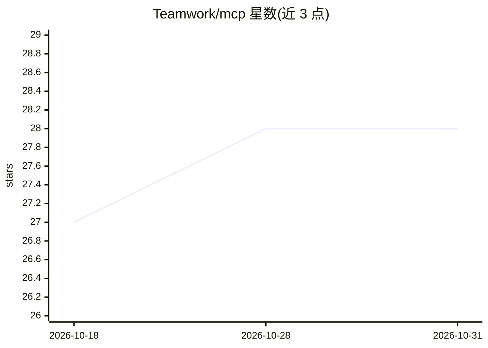

# Teamwork/mcp

⭐ 28 · Go · MIT · 推送 2026-10-30 · [GitHub](https://github.com/Teamwork/mcp) · [官网](https://mcp.ai.teamwork.com) · 组织维护

**Teamwork.com 的 MCP 服务器：让 LLM 操作项目管理平台**

由 Teamwork.com 官方维护的 Model Context Protocol 服务器，将 Teamwork.com 的项目、Desk、Spaces、Chat 中的 create/read/update 操作以 MCP 工具形式暴露给 LLM 与 AI agent。提供三种运行形态：HTTP 服务器（面向云部署与多客户端）、STDIO 服务器（面向桌面应用与开发环境）、HTTP CLI 调试工具。认证支持 Bearer token 与 OAuth2，可选只读模式限制写操作，需 Go 1.27+ 与 Teamwork.com API 凭据。

## 筛选速览

| 维度 | 判定 | 备注 |
|---|---|---|
| AI 角色 | `ai-ecosystem` | LLM/agent 周边工具 |
| 许可风险 | `permissive` | MIT |
| 部署形态 | `library` | 以包/库形式分发 |
| 模型依赖 | — | README 未给出锁定关系 |
| 硬件要求 | — | 无带数字的原话,不猜 |
| 安装摩擦 | `low` | 无编译、无系统依赖或容器化 |
| 成熟度 | — | 结构信号不足 |

## 能力要点

- HTTP 与 STDIO 两种传输模式，另带 HTTP CLI 调试工具
- Bearer token 与 OAuth2 认证，可选只读模式
- 工具集覆盖 Projects、Desk、Spaces、Chat 的增删查改操作
- 可扩展的工具框架架构

## 适用场景

- 让 AI agent 在对话中执行 Teamwork.com 项目管理操作
- 为桌面 MCP 客户端接入 Teamwork.com 数据
- 调试和验证 Teamwork MCP 工具调用

## 场景标签

`工作流自动化` · 领域:效率与自动化

## 证据(README 行号)

> L16: This MCP (Model Context Protocol) server enables seamless integration between
> L24: applications provide context to LLMs. This server describes all the actions
> L43: This project provides three different ways to interact with the Teamwork.com MCP

## 星数曲线

2026-10-18 27 → 2026-10-31 28（+1）

---
*卡片 v1 · prompt 1.4 · 生成 2026-10-26 · 置信度 mid · 依据 README sha `53ed96b5c384` · [字段定义](../../DATASET.md)*
