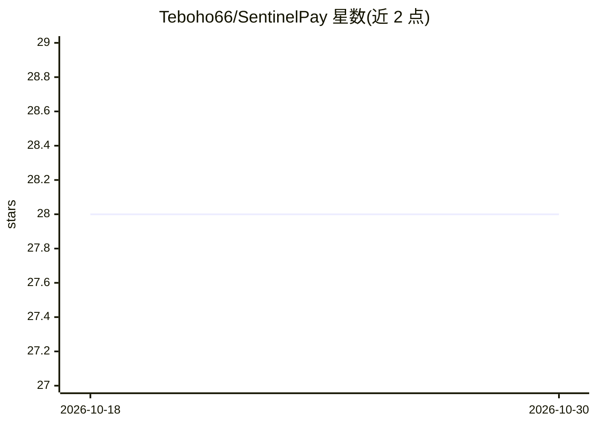

# Teboho66/SentinelPay

⭐ 28 · Python · NOASSERTION · 推送 2026-06-08 · [GitHub](https://github.com/Teboho66/SentinelPay) · [官网](https://teboho66.github.io/SentinelPay) · 个人维护

**面向金融支付场景的实时欺诈检测引擎（FastAPI + ML 集成）**

CPUT 软件工程研究生课程项目：以 FastAPI 提供 REST API 的欺诈检测与预防引擎，覆盖交易提交与 ML 集成评分、批准/标记/阻断决策、欺诈案件调查队列、ML 模型版本生命周期管理与热替换，以及 SHAP 可解释性（规划项）。当前 API 使用内存仓储，XGBoost/Isolation Forest/DistilBERT、Kafka、PostgreSQL/Redis 等列为 planned 技术栈；Docker Compose 可启动 API+PostgreSQL+Redis 本地栈，共 288 个测试与 GitHub Actions CI/CD。仓库同时包含 3-9 号课程作业的规格、架构与建模文档。

## 筛选速览

| 维度 | 判定 | 备注 |
|---|---|---|
| AI 角色 | `ai-native` | 本体是模型或模型工具 |
| 许可风险 | `none` | NOASSERTION |
| 部署形态 | `self-host` | docker 或自建部署 |
| 模型依赖 | — | README 未给出锁定关系 |
| 硬件要求 | — | 无带数字的原话,不猜 |
| 安装摩擦 | `low` | 无编译、无系统依赖或容器化 |
| 成熟度 | `idea` | |

## 能力要点

- 交易欺诈评分 API：approve/flag/block 决策与按风险等级的阈值配置
- 欺诈案件调查队列（P1→P2→P3）与分析师分配/解决流程
- ML 模型版本注册、评估指标记录、promote 与热替换端点
- docker compose 启动 API+PostgreSQL+Redis 本地全栈，288 个测试

## 适用场景

- 支付平台为交易流接入实时欺诈评分 API
- 欺诈分析师在案件队列中处理 HIGH/CRITICAL 级别告警
- 作为课程/学习项目参考事件驱动欺诈检测系统的架构与流程

## 场景标签

 · 领域:金融科技/风控

## 证据(README 行号)

> L21: SentinelPay is an intelligent, real-time fraud detection and prevention engine designed for modern financial instit
> L28: - **Score** every transaction in real time using a multi-model ML ensemble (XGBoost + Isolation Forest + fine-tuned

## 星数曲线

2026-10-18 28 → 2026-10-30 28（+0）

---
*卡片 v1 · prompt 1.4 · 生成 2026-10-26 · 置信度 mid · 依据 README sha `98684e49e0e7` · [字段定义](../../DATASET.md)*
