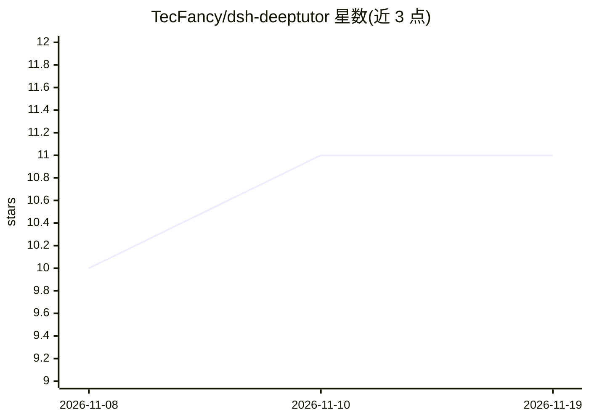

# TecFancy/dsh-deeptutor

⭐ 11 · TypeScript · MIT · 推送 2026-11-18 · [GitHub](https://github.com/TecFancy/dsh-deeptutor) · 个人维护

**把 DeepTutor 辅导能力接入 agent 的插件：讲解、自测、RAG**

DeepSeek Harness (dsh) 与 Claude Code 的学习辅助扩展，通过四个 agent 工具（deeptutor_run/kb/note/cli）驱动 HKUDS/DeepTutor 服务：深度讲解、自测题、学习路径规划、个人知识库检索（RAG）与笔记归档。能力在运行时从 CLI 发现而非硬编码，非 read 类命令经 confirm/blocked 安全分级过滤；讲解可渲染为自包含 HTML 学习页。需 Node ≥ 20 及一份本地或远程的 DeepTutor 部署（经 SSH 调用远程 CLI）。

## 筛选速览

| 维度 | 判定 | 备注 |
|---|---|---|
| AI 角色 | `ai-native` | 本体是模型或模型工具 |
| 许可风险 | `permissive` | MIT |
| 部署形态 | `desktop` | 安装包/桌面程序 |
| 模型依赖 | — | README 未给出锁定关系 |
| 硬件要求 | — | 无带数字的原话,不猜 |
| 安装摩擦 | `medium` | 含编译或系统依赖之一 |
| 成熟度 | — | 结构信号不足 |

## 能力要点

- 四个 agent 工具：运行能力、检索知识库、归档笔记、CLI 透传
- 运行时发现 DeepTutor 能力，上游升级无需改插件
- read/confirm/blocked 三级安全分级约束 CLI 透传
- 讲解答案可渲染为自包含 HTML 学习页并写入笔记本

## 适用场景

- 在 Claude Code / dsh 会话中让 agent 讲解技术主题并生成学习页
- 让 agent 基于个人知识库检索后作答并归档学习笔记
- 为学习流程生成自测题与学习路径

## 场景标签

`知识库管理` `RAG` `教程课程` · 领域:知识与检索

## 证据(README 行号)

> L5: A **learning-assistant extension for DeepSeek Harness (dsh) and Claude Code**.
> L6: It connects your agent to a HKUDS/DeepTutor
> L23: |`deeptutor_run`|Runs one learning capability, e.g. `deep_solve` (in-depth explanation), `deep_question` (self-test

## 星数曲线

2026-11-08 10 → 2026-11-19 11（+1）

---
*卡片 v1 · prompt 1.4 · 生成 2026-11-18 · 置信度 high · 依据 README sha `05767fd55a04` · [字段定义](../../DATASET.md)*
