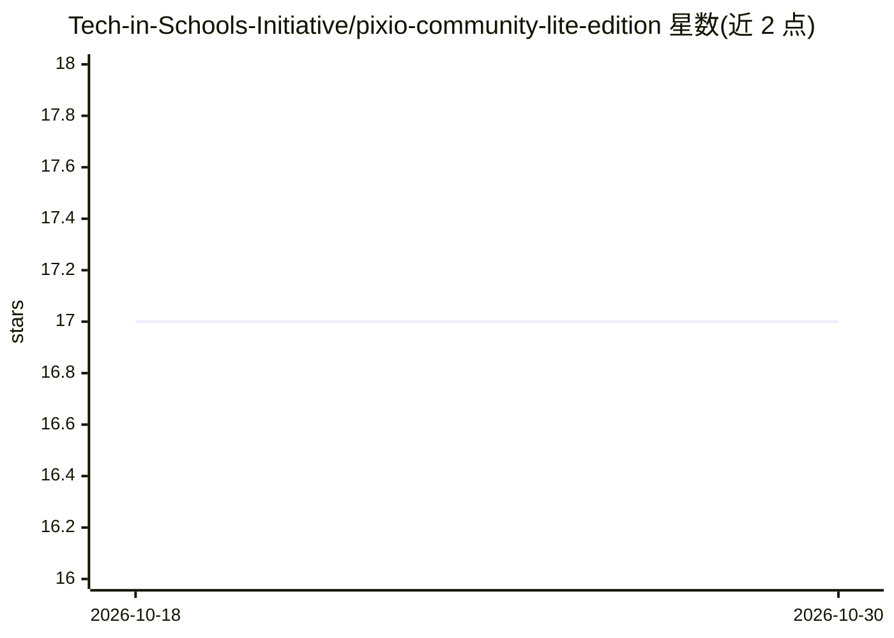

# Tech-in-Schools-Initiative/pixio-community-lite-edition

⭐ 17 · TypeScript · GPL-3.0 · 推送 2026-06-27 · [GitHub](https://github.com/Tech-in-Schools-Initiative/pixio-community-lite-edition) · [官网](https://beta.pixio.myapps.ai/) · 组织维护

**基于 Prodia API 的开源 AI 媒体生成工作室（图像/视频/音频）**

Pixio Studio 是一个 Next.js 网页应用，通过 Prodia v2 API 提供 txt2img、img2img、inpaint、upscale、segment、txt2vid 等多种 AI 生成与编辑操作，模型目录覆盖 FLUX、Stable Diffusion、Gemini、Veo、Sora 2 等。应用提供三种界面：Studio（并行运行与成本追踪）、Konva 画布（Canvas）和 React Flow 工作流节点图（Nodes）。用户自带 Prodia API key 在浏览器本地存储，也可配置服务端回退 key；可选配置 OpenAI key 启用提示词改写与图生提示词。支持本地 npm 运行、Vercel 部署与 Docker 部署，静态导出不受支持。

## 筛选速览

| 维度 | 判定 | 备注 |
|---|---|---|
| AI 角色 | `ai-native` | 本体是模型或模型工具 |
| 许可风险 | `viral` | GPL-3.0 |
| 部署形态 | `self-host` | docker 或自建部署 |
| 模型依赖 | — | README 未给出锁定关系 |
| 硬件要求 | — | 无带数字的原话,不猜 |
| 安装摩擦 | `low` | 无编译、无系统依赖或容器化 |
| 成熟度 | — | 结构信号不足 |

## 能力要点

- 三种创作界面：Studio、Konva Canvas、React Flow Nodes 工作流图
- 通过单一 /api/job 路由代理 Prodia v2 推理，覆盖图像/视频/音频/SVG 等操作
- 浏览器本地存储 API key 的自带 key 模式，服务端 PRODIA_KEY 为可选回退
- 通过 ?price=true 实现按作业的 Prodia 成本追踪

## 适用场景

- 输入提示词并选择模型生成或编辑图像、视频
- 在节点图中链式组合多个模型完成复杂创作流程
- 团队部署一套共享的 AI 媒体生成工作台，自配 key 或用服务端 key

## 场景标签

`图像生成` `视频生成` · 领域:内容生成

## 证据(README 行号)

> L3: The open-source AI media studio for Prodia.
> L20: - Prodia v2 inference through a single app route: `POST /api/job`.
> L64: |`txt2img`|FLUX, Stable Diffusion, Gemini, Seedream, Recraft|Studio, Canvas, Nodes|

## 星数曲线

2026-10-18 17 → 2026-10-30 17（+0）

---
*卡片 v1 · prompt 1.4 · 生成 2026-10-29 · 置信度 high · 依据 README sha `3c450cdb8fc1` · [字段定义](../../DATASET.md)*
