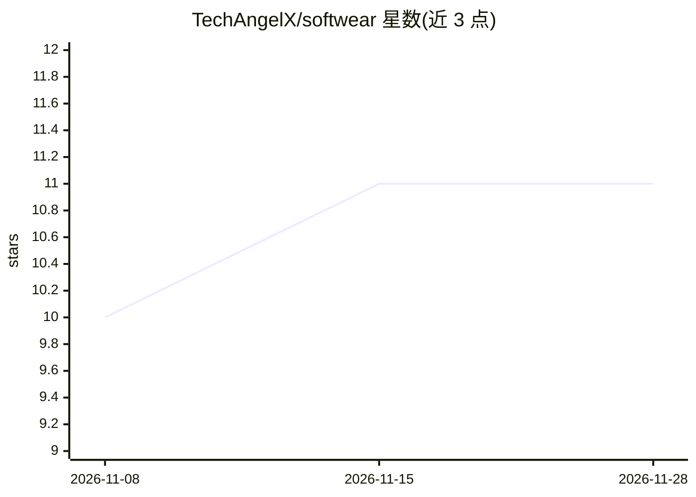

# TechAngelX/softwear

⭐ 11 · JavaScript · 推送 2026-06-13 · [GitHub](https://github.com/TechAngelX/softwear) · [官网](https://softwear.techangelx.com) · 个人维护

**浏览器端实时虚拟试穿平台：摄像头捕捉动作并叠加 3D 数字服装**

基于 React、Three.js 与 Mediapipe 构建的实时虚拟试穿平台，读取摄像头画面，用 Mediapipe 与 ONNX Runtime 追踪身体姿态并映射到 3D 网格，叠加带布料物理模拟与光照的数字服装。模型以压缩 GLTF/DRACO 格式从 /public/models 加载，需 Node.js 18+、支持 WebGL 2 的浏览器与 HTTPS 环境运行，通过 npm 安装与构建，MIT 许可。

## 筛选速览

| 维度 | 判定 | 备注 |
|---|---|---|
| AI 角色 | `ai-native` | 本体是模型或模型工具 |
| 许可风险 | `none` | — |
| 部署形态 | `library` | 以包/库形式分发 |
| 模型依赖 | — | README 未给出锁定关系 |
| 硬件要求 | — | 无带数字的原话,不猜 |
| 安装摩擦 | `low` | 无编译、无系统依赖或容器化 |
| 成熟度 | — | 结构信号不足 |

## 能力要点

- Mediapipe 与 ONNX Runtime 实时身体/姿态追踪
- Three.js 与 WebGL 着色器实现 3D 服装叠加
- WebAssembly 引擎的布料物理模拟
- GLTF/DRACO 压缩模型加载

## 适用场景

- 在浏览器中试穿数字服装并查看动态效果
- 为数字时尚展示搭建线上试穿页面

## 场景标签

`目标检测` · 领域:感知与多模态

## 证据(README 行号)

> L3: Softwear is a real-time virtual try-on platform built with React, Three.js, and Mediapipe. It uses live camera input
> L16: - Live body tracking using Mediapipe and ONNX Runtime
> L29: - Mediapipe / ONNX Runtime — Body and pose tracking

## 星数曲线

2026-11-08 10 → 2026-11-28 11（+1）

---
*卡片 v1 · prompt 1.4 · 生成 2026-11-18 · 置信度 high · 依据 README sha `df7b1436e547` · [字段定义](../../DATASET.md)*
