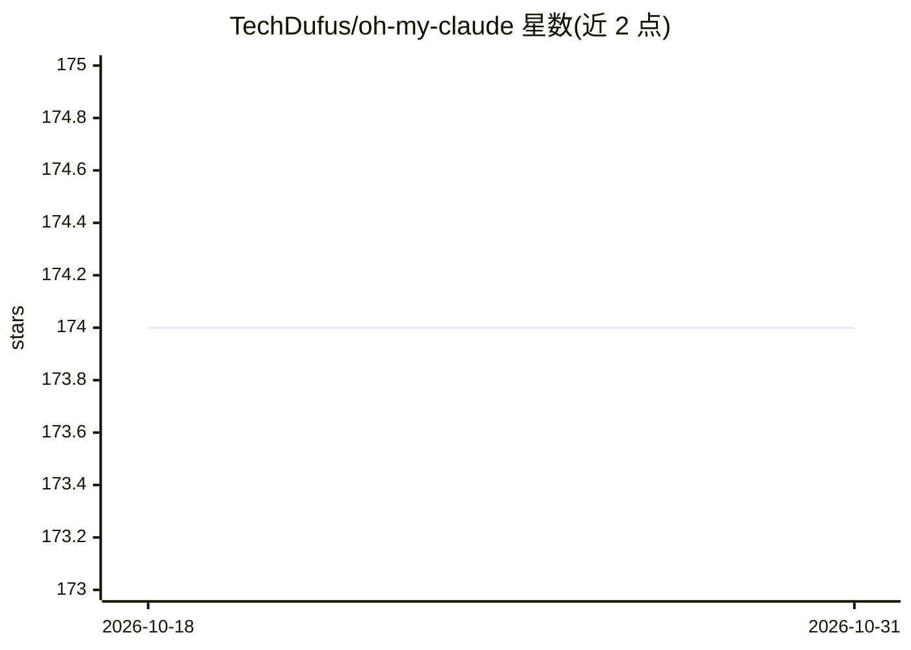

# TechDufus/oh-my-claude

⭐ 174 · Python · MIT · 推送 2026-07-13 · [GitHub](https://github.com/TechDufus/oh-my-claude) · [官网](https://oh-my-claude.techdufus.com) · 个人维护

**Claude Code 插件：触发词驱动并行执行与审查门禁**

面向 Claude Code 用户的插件，通过在提示中加入 ultrawork/ultraresearch/ultradebug 等触发词改变执行行为：钩子拦截提示并注入指令，促使 Claude 并行派发子代理、强制 TodoWrite 进度跟踪、全部完成并通过校验才停止。提供 advisor/critic/librarian/validator/security-auditor 等 7 个专用子代理，并自动启用 7 步增强计划模式。依赖 uv 运行时，经 Claude Code 插件市场安装，macOS/Linux/Windows 可用。

## 筛选速览

| 维度 | 判定 | 备注 |
|---|---|---|
| AI 角色 | `ai-ecosystem` | LLM/agent 周边工具 |
| 许可风险 | `permissive` | MIT |
| 部署形态 | `None` |  |
| 模型依赖 | locked-api |  |
| 硬件要求 | — | 无带数字的原话,不猜 |
| 安装摩擦 | `low` | 无编译、无系统依赖或容器化 |
| 成熟度 | — | 结构信号不足 |

## 能力要点

- ultrawork 等触发词启用最大并行执行与强制任务跟踪
- 7 个专用子代理（计划审查、风险、校验、安全审计等）
- 7 个自动化钩子（上下文守卫、todo 强制、安全命令自动批准等）
- 增强计划模式自动执行 7 步流程（侦察→访谈→批评审查）

## 适用场景

- 让 Claude Code 并行执行大规模重构或修错任务
- 在执行前对计划做缺口分析与风险审查
- 通过子代理读取大文件以保护主会话上下文

## 场景标签

`编码 Agent` `代码审查` · 领域:编码与开发

## 证据(README 行号)

> L9:  Opinionated Claude Code plugin for ultrawork, orchestration guardrails, and review gates.
> L105: The hook intercepts your prompt, detects the keyword, and injects context that guides Claude toward quality gates 
> L55: /plugin marketplace add TechDufus/oh-my-claude

## 星数曲线

2026-10-18 174 → 2026-10-31 174（+0）

---
*卡片 v1 · prompt 1.4 · 生成 2026-10-22 · 置信度 high · 依据 README sha `9dee05aaa095` · [字段定义](../../DATASET.md)*
