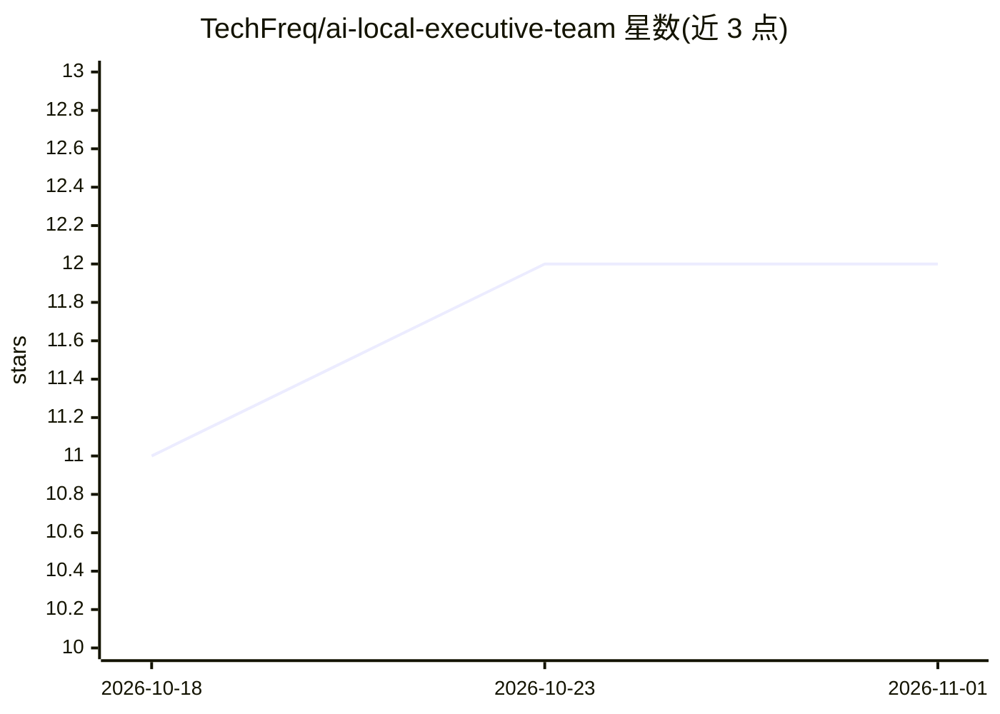

# TechFreq/ai-local-executive-team

⭐ 12 · Python · MIT · 推送 2026-05-20 · [GitHub](https://github.com/TechFreq/ai-local-executive-team) · [官网](https://beacons.ai/techfreq) · 个人维护

**本地多 agent 高管团队编排桥：五个本地模型经统一 API 服务各类客户端**

运行在本机 LM Studio 之上的多智能体编排层：将 CEO/CTO/CFO/CPO/COO 五个角色分配给不同本地模型，CEO 开场、CTO+CFO+CPO 并行、COO 汇总执行计划、CEO 收尾决策；按消息自动路由到全会或单一 agent。桥接服务器监听 5555 端口，同时提供 OpenAI 与 Ollama 两种 API 格式，供 OpenWebUI、Continue、Cline、Claude Code 等客户端接入。含 6 档质量预设热键切换、基于使用记录的自学习超时与可靠性评分、以及 T 键配置基准自动调优。要求 NVIDIA GPU 8GB+ VRAM，测试环境为 RTX 3060 12GB + 64GB RAM，大模型需 GPU+RAM 混合卸载。

## 筛选速览

| 维度 | 判定 | 备注 |
|---|---|---|
| AI 角色 | `ai-ecosystem` | LLM/agent 周边工具 |
| 许可风险 | `permissive` | MIT |
| 部署形态 | `library` | 以包/库形式分发 |
| 模型依赖 | local-ok | 支持本地模型 |
| 硬件要求 | `gpu-8g` | |
| 安装摩擦 | `medium` | 含编译或系统依赖之一 |
| 成熟度 | — | 结构信号不足 |

## 能力要点

- 五角色模型分工的董事会式多 agent 流程，自动意图路由
- 单一端口同时提供 OpenAI 与 Ollama 两种 API 格式
- 记录 TTFT/成功率的自学习性能系统，自动上调超时并推荐各角色最优模型
- T 键自动调优：对上下文/KV cache/Flash Attention 配置矩阵做基准测试

## 适用场景

- 给 OpenWebUI、Continue、Cline 等客户端接一个本地多 agent 后端
- 在自有 GPU 上获得分角色协作的问答与分析，替代云 API 订阅
- 对本地模型加载配置做基准测试并固化最优设置

## 场景标签

`多智能体` `模型网关` · 领域:Agent 开发

## 证据(README 行号)

> L20: Load multiple specialized models simultaneously
> L23: Serve any OpenAI or Ollama compatible client
> L207: The bridge listens on `http://localhost:5555` and speaks both formats simultaneously.

## 星数曲线

2026-10-18 11 → 2026-11-01 12（+1）

---
*卡片 v1 · prompt 1.4 · 生成 2026-11-01 · 置信度 high · 依据 README sha `f04f7d970517` · [字段定义](../../DATASET.md)*
