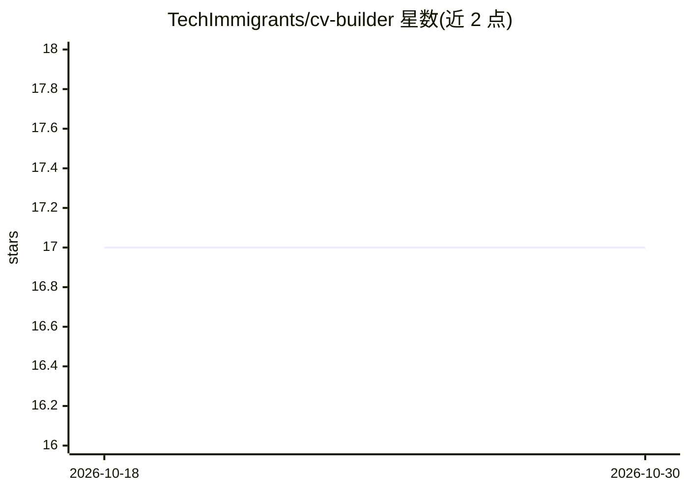

# TechImmigrants/cv-builder

⭐ 17 · TypeScript · MIT · 推送 2026-08-24 · [GitHub](https://github.com/TechImmigrants/cv-builder) · [官网](https://ci-cloudflare-pages-preview.cv-builder-cf-web.pages.dev/) · 组织维护

**给科技从业者与移民求职者的开源简历评估工具：打分并给出修改清单**

由 Tech Immigrants 社区构建的开源简历评估器：粘贴简历与可选职位描述，按六个维度（产出证据、量化影响、工具可见性、ATS 兼容、关键词匹配、公开证明）输出 0–5 评分与按优先级排序的问题及修复建议。评分权重按 8 种角色原型（AI 工程师、后端、DevOps 等）区分。隐私优先：Web UI 全程在浏览器运行，CLI 本地读取文件输出到 stdout，无遥测无上传。当前为首个社区 MVP，仅评估不生成或改写简历；提供 CLI、本地 Web UI 与 Claude Code 运行三种方式，LLM 增强改写列为 v0.2 规划。

## 筛选速览

| 维度 | 判定 | 备注 |
|---|---|---|
| AI 角色 | `ai-enhanced` | 去掉 AI 部分产品仍成立 |
| 许可风险 | `permissive` | MIT |
| 部署形态 | `library` | 以包/库形式分发 |
| 模型依赖 | — | README 未给出锁定关系 |
| 硬件要求 | — | 无带数字的原话,不猜 |
| 安装摩擦 | `low` | 无编译、无系统依赖或容器化 |
| 成熟度 | `idea` | |

## 能力要点

- 六维度 0–5 评分与优先级排序的问题修复清单
- 8 种角色原型差异化权重评分
- 隐私优先：浏览器本地运行 / CLI 本地文件，无遥测无上传
- 规则基于 250+ 引用来源（research/sources.md），规则可审计可解释

## 适用场景

- 投递前检查简历是否会被 ATS 正确解析、关键词是否匹配 JD
- 按目标角色（如 AI 工程师）获取针对性的简历问题清单
- 网络受限或不愿上传简历到第三方服务的求职者本地评估简历

## 场景标签

 · 领域:求职/职业工具

## 证据(README 行号)

> L3: **Paste your CV and an optional job description. Get a 0–5 evaluation across six dimensions, with a prioritised list
> L5: This is the **first community MVP**: it scores an existing resume, it does not generate, tailor, or rewrite one. An 

## 星数曲线

2026-10-18 17 → 2026-10-30 17（+0）

---
*卡片 v1 · prompt 1.4 · 生成 2026-10-29 · 置信度 mid · 依据 README sha `e5fadce6f683` · [字段定义](../../DATASET.md)*
