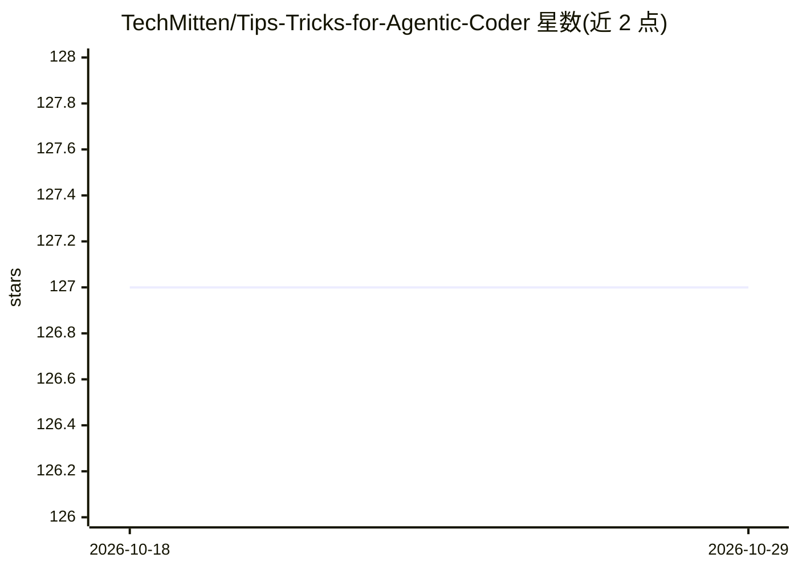

# TechMitten/Tips-Tricks-for-Agentic-Coder

⭐ 127 · 推送 2026-07-05 · [GitHub](https://github.com/TechMitten/Tips-Tricks-for-Agentic-Coder) · [官网](https://techray.dev) · 个人维护

**面向初学者的 AI 辅助编码入门指南（英文教程）**

一份 Markdown 编写的教学指南，教零基础开发者如何使用 AI 编码工具构建网站与应用。内容涵盖环境搭建（IDE/扩展选择、Git、浏览器开发者工具）、提示词模板（修复/新增功能/删除功能等 6 类场景）、故障排查（重开对话清理上下文、定位相互冲突的代码）等章节，并附练习与术语表。作者为入门开发者，基于个人实践经验撰写；2025 年 7 月更新声明指出部分技术限制描述已过时，需读者自行核实现有工具能力。

## 筛选速览

| 维度 | 判定 | 备注 |
|---|---|---|
| AI 角色 | `ai-knowledge` | 知识聚合/清单类 |
| 许可风险 | `none` | — |
| 部署形态 | `None` |  |
| 模型依赖 | — | README 未给出锁定关系 |
| 硬件要求 | — | 无带数字的原话,不猜 |
| 安装摩擦 | `low` | 无编译、无系统依赖或容器化 |
| 成熟度 | `idea` | |

## 能力要点

- 6 类任务场景的提示词模板与配套练习
- 环境搭建章节覆盖 IDE/扩展、Git 与浏览器开发者工具
- 故障排查方法：新开对话重置上下文、定位冲突代码

## 适用场景

- 零基础入门 AI 辅助网页/应用开发
- 学习面向具体任务的提示词写法
- AI 编码助手输出不符预期时排查原因

## 场景标签

`教程课程` `提示工程` · 领域:Agent 开发

## 证据(README 行号)

> L5: Welcome to the **Ultimate Agentic Coding Guide for Beginners**, a comprehensive resource designed to help developers
> L3: > **📝 Content Update Notice (July 2025):** This guide was originally written when AI development tools were in their

## 星数曲线

2026-10-18 127 → 2026-10-29 127（+0）

---
*卡片 v1 · prompt 1.4 · 生成 2026-10-23 · 置信度 high · 依据 README sha `8b4a3eca4ab2` · [字段定义](../../DATASET.md)*
