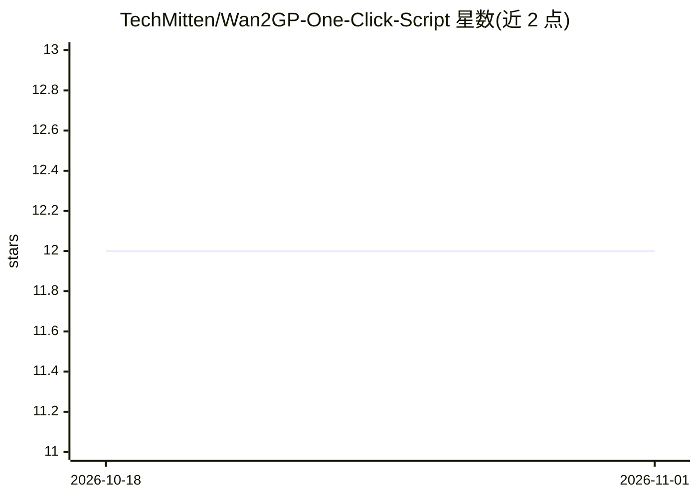

# TechMitten/Wan2GP-One-Click-Script

⭐ 12 · Batchfile · MIT · 推送 2026-08-23 · [GitHub](https://github.com/TechMitten/Wan2GP-One-Click-Script) · 个人维护

**Windows 上一键安装运行 Wan2GP 文生视频的自动化脚本**

面向 Windows 用户的一键安装脚本（.bat + 内嵌 PowerShell），自动安装 Python 3.10、Git、匹配 GPU 对应的 PyTorch + CUDA 版本，下载 Wan2GP 源码与模型权重，完成后在浏览器 localhost:7860 打开应用；并提供启动/更新/修复菜单与日志。要求 Windows 10/11 64 位、NVIDIA RTX 20 系及以上显卡与 50GB+ 磁盘，不支持 AMD/Intel 显卡。卸载即删除 %USERPROFILE%\Wan2GP\ 目录。

## 筛选速览

| 维度 | 判定 | 备注 |
|---|---|---|
| AI 角色 | `ai-ecosystem` | LLM/agent 周边工具 |
| 许可风险 | `permissive` | MIT |
| 部署形态 | `desktop` | 安装包/桌面程序 |
| 模型依赖 | — | README 未给出锁定关系 |
| 硬件要求 | — | 无带数字的原话,不猜 |
| 安装摩擦 | `medium` | 含编译或系统依赖之一 |
| 成熟度 | — | 结构信号不足 |

## 能力要点

- 自动安装 Python/Git 并按 GPU 算力匹配 PyTorch + CUDA 版本
- 启动器菜单支持 Launch/Update/Repair，修复不删除已下载权重
- v2 提供多 GB 文件的实时下载进度与会话日志
- 脚本采用 MIT 许可，核心应用许可见上游 Wan2GP 仓库

## 适用场景

- 不会命令行操作的用户在本地 NVIDIA 显卡上安装运行 Wan2GP
- 一键修复或更新已有的 Wan2GP 本地环境
- 低显存用户快速搭建文生视频生成环境

## 场景标签

`视频生成` · 领域:内容生成

## 证据(README 行号)

> L3: An automated setup script to install and run Wan2GP locally on Windows. Generate AI videos directly on your NVIDIA G
> L37: * Downloading the latest **Wan2GP** source code and libraries.

## 星数曲线

2026-10-18 12 → 2026-11-01 12（+0）

---
*卡片 v1 · prompt 1.4 · 生成 2026-11-01 · 置信度 high · 依据 README sha `5506127ee6ac` · [字段定义](../../DATASET.md)*
