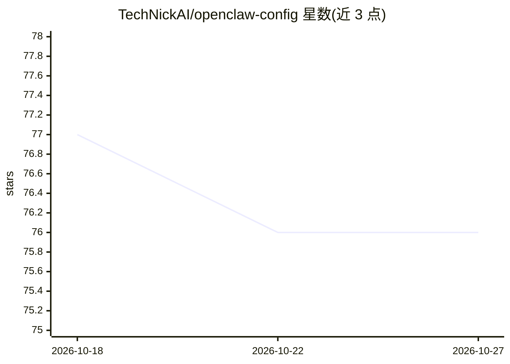

# TechNickAI/openclaw-config

⭐ 76 · Python · 推送 2026-08-04 · [GitHub](https://github.com/TechNickAI/openclaw-config) · 个人维护

**把 Claude Code 变成有记忆、技能和自主工作流的个人 AI 配置层**

面向个人用户的共享配置层，构建于 Claude Code 之上：提供三层持久记忆（常驻上下文、每日上下文文件、向量检索的深度知识）、约 19 个独立 UV 脚本技能（网络研究、会议转录、CRM、电话、任务管理等）、以及定时运行的自主工作流 Agent（邮件分流、日历准备、安全巡检、自我改进等）。全部由 Markdown 与 Python 脚本组成，无框架与数据库；附跨 macOS/Linux 的健康检查、备份与多机队管理 DevOps 方案。前置条件是本机已运行 Claude Code。

## 筛选速览

| 维度 | 判定 | 备注 |
|---|---|---|
| AI 角色 | `ai-native` | 本体是模型或模型工具 |
| 许可风险 | `none` | — |
| 部署形态 | `library` | 以包/库形式分发 |
| 模型依赖 | locked-api |  |
| 硬件要求 | — | 无带数字的原话,不猜 |
| 安装摩擦 | `low` | 无编译、无系统依赖或容器化 |
| 成熟度 | — | 结构信号不足 |

## 能力要点

- 三层记忆架构：常驻 MEMORY.md、每日上下文文件、向量检索深度知识
- 约 19 个独立 UV 脚本技能与 9 个定时自主工作流 Agent
- 每小时（30 分钟级）健康检查、Restic 备份、安全加固与多机队管理 DevOps
- 全 Markdown + Python 脚本，无框架无数据库，git 管理

## 适用场景

- 让个人 AI 助手跨对话记住我的偏好与知识
- 定时自动分流邮件、准备日程、巡检安全与 cron 任务
- 把会议转录、CRM、电话等真实工具接入 AI 助手

## 场景标签

`AI 助手` `工作流自动化` `Agent 记忆` · 领域:Agent 开发

## 证据(README 行号)

> L8:  Give your AI assistant memory, skills, and autonomy.
> L16: This repo is the shared configuration layer for OpenClaw — a personal AI built on
> L18: memory, integrates with real-world tools, and runs autonomous workflows on a schedule.

## 星数曲线

2026-10-18 77 → 2026-10-27 76（-1）

---
*卡片 v1 · prompt 1.4 · 生成 2026-10-24 · 置信度 mid · 依据 README sha `80571c74e93b` · [字段定义](../../DATASET.md)*
