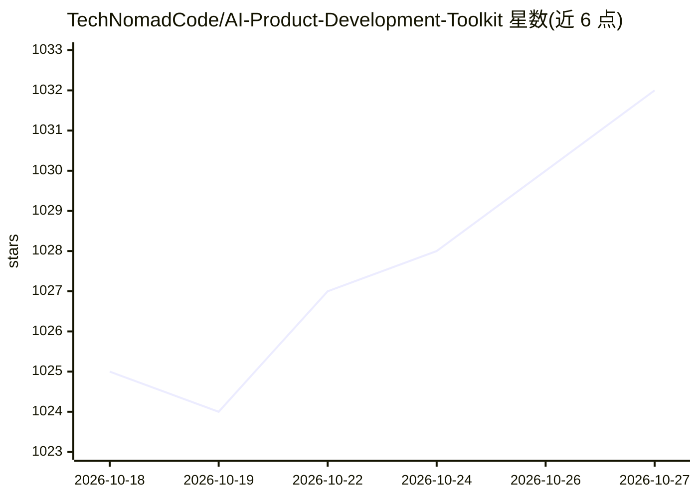

# TechNomadCode/AI-Product-Development-Toolkit

⭐ 1,032 · MIT · 推送 2026-10-17 · [GitHub](https://github.com/TechNomadCode/AI-Product-Development-Toolkit) · [官网](https://promptquick.ai) · 个人维护

**面向 AI 编程代理的产品开发提示词与技能工具包**

一套产品开发流程资产：6 步规划提示词（用户研究→PRD→UX→MVP 范围→构建计划→测试计划），以采访式问答生成文档；AI App Starter 提供分阶段指令让 Claude Code 或 Codex 代理引导用户搭建 Next.js+Supabase+Vercel 应用；8 个可按名称调用的技能（含 Remotion 代码生成产品视频）与多份 Claude 代理配置文件。安装方式为让代理 git clone 仓库并执行 SETUP/INSTALL 文件。Codex 与上线部署未经测试。

## 筛选速览

| 维度 | 判定 | 备注 |
|---|---|---|
| AI 角色 | `ai-ecosystem` | LLM/agent 周边工具 |
| 许可风险 | `permissive` | MIT |
| 部署形态 | `None` |  |
| 模型依赖 | — | README 未给出锁定关系 |
| 硬件要求 | — | 无带数字的原话,不猜 |
| 安装摩擦 | `low` | 无编译、无系统依赖或容器化 |
| 成熟度 | — | 结构信号不足 |

## 能力要点

- 6 步采访式规划提示词链，后续步骤复用前序文档
- AI App Starter 分阶段指令引导代理搭建 Next.js/Supabase/Vercel 应用
- 8 个按名称运行的技能（含 Remotion 代码生成产品短视频）
- 多份 Claude 代理 CLAUDE.md 配置文件

## 适用场景

- 用 AI 采访式提问把想法整理成 PRD 与 MVP 计划
- 让 Claude Code 或 Codex 从空文件夹引导搭建并上线 Web 应用
- 为 Claude Code 配置日常工作规则

## 场景标签

`提示工程` · 领域:Agent 开发

## 证据(README 行号)

> L12: |**AI App Starter**|Instructions your coding agent follows to build a web app with you, step by step, up to launch.
> L40: The AI App Starter turns your AI coding agent into a guide that builds a Next.js, Supabase and Vercel app with you,
> L79: Install the AI Product Development Toolkit skills: clone https://github.com/TechNomadCode/AI-Product-Development-To

## 星数曲线

2026-10-18 1,025 → 2026-10-27 1,032（+7）

---
*卡片 v1 · prompt 1.4 · 生成 2026-10-21 · 置信度 high · 依据 README sha `c11e2a702842` · [字段定义](../../DATASET.md)*
