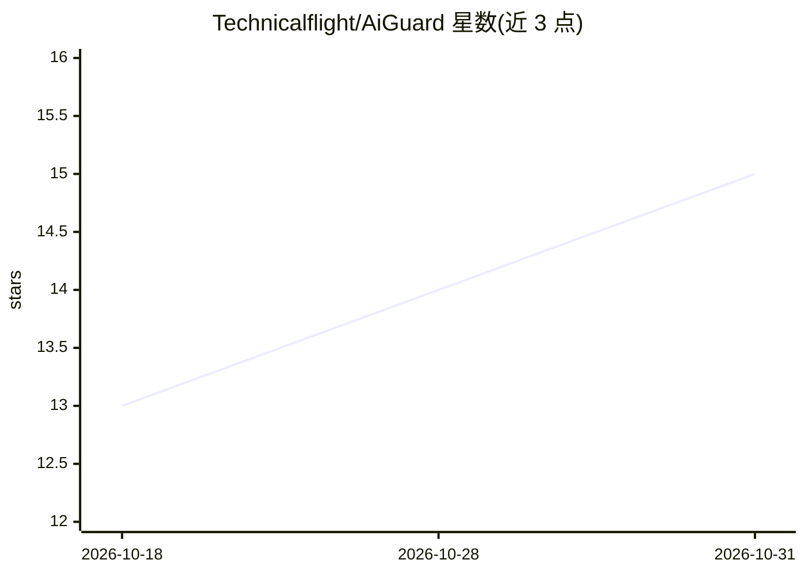

# Technicalflight/AiGuard

⭐ 15 · Rust · AGPL-3.0 · 推送 2026-10-01 · [GitHub](https://github.com/Technicalflight/AiGuard) · [官网](https://technicalflight.github.io/AiGuard/) · 个人维护 · 中文 README

**本地优先的 AI 流量安全网关：脱敏出网请求、还原响应并审计风险**

运行在用户本机的 MITM 代理：通过系统代理 + PAC 仅接管 AI 域名流量，用自签根证书解密 HTTPS，在请求出网前将身份证、手机号、API Key 等六类敏感信息替换为可还原占位符，AI 回复（含 SSE 流式）回程时在本地逐帧还原；同时只读审计报错泄密、模型偷换等七类风险信号，原文不落盘不上传。以 Tauri 桌面应用提供 Windows/macOS/Linux 安装包，处于 v0.1.x 早期阶段；证书固定的应用与 QUIC 流量无法拦截。

## 筛选速览

| 维度 | 判定 | 备注 |
|---|---|---|
| AI 角色 | `ai-ecosystem` | LLM/agent 周边工具 |
| 许可风险 | `dual` | AGPL-3.0 |
| 部署形态 | `desktop` | 安装包/桌面程序 |
| 模型依赖 | — | README 未给出锁定关系 |
| 硬件要求 | — | 无带数字的原话,不猜 |
| 安装摩擦 | `low` | 无编译、无系统依赖或容器化 |
| 成熟度 | `idea` | |

## 能力要点

- 系统代理 + PAC 只接管 AI 域名流量，其余直连不受影响
- 6 类检测规则脱敏（可改正则与动作），占位符在响应侧流式还原
- 七类防护信号只读审计 + 注入追踪标记的主动核查
- 黑/白名单支持域名与进程级匹配（exe 路径/文件夹/文件名）

## 适用场景

- 防止我在使用 AI 应用时身份证、手机号等敏感信息发往上游
- 审计上游 AI 服务的泄密、模型偷换等异常行为
- 对特定应用或域名设置直通/强制拦截策略

## 场景标签

`网络安全` · 领域:学习与行业

## 证据(README 行号)

> L27: AiGuard 是一个**本地优先**的 AI 流量安全网关：以系统代理 + 自签根证书接管发往 AI 服务的 HTTPS 流量，在请求出网前完成敏感信息脱敏，在响应回程时完成流式还原，并全程只读审计上游行为。它不代理你的数据到任
> L33: - 覆盖 OpenAI / Anthropic / DeepSeek / Moonshot / 智谱 等主流 AI 服务的 **API 与网页端**域名

## 星数曲线

2026-10-18 13 → 2026-10-31 15（+2）

---
*卡片 v1 · prompt 1.4 · 生成 2026-10-31 · 置信度 mid · 依据 README sha `3b05926e9ffa` · [字段定义](../../DATASET.md)*
